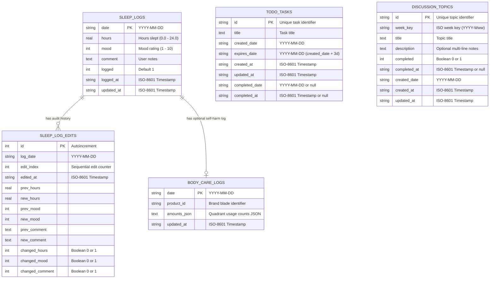
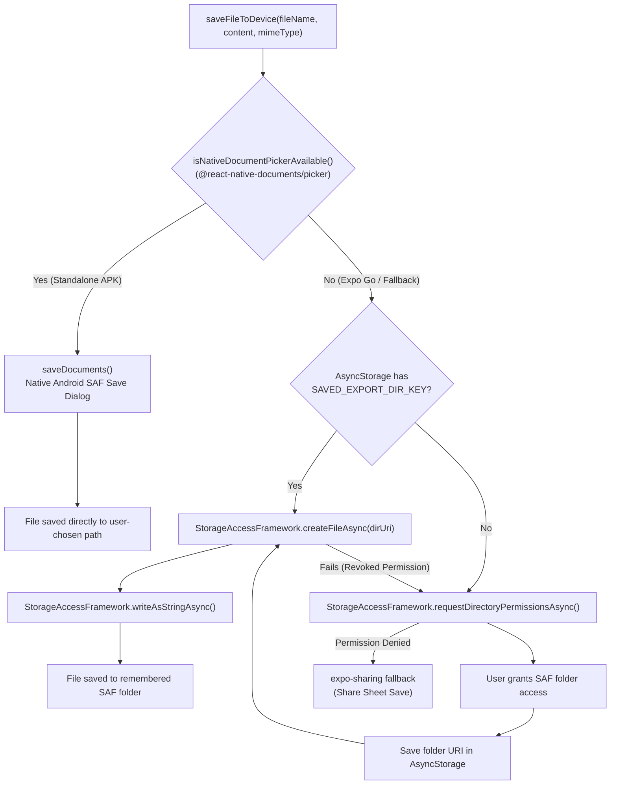

# Comprehensive Technical Documentation: `simple-sleep-journal`

This document serves as the architectural and technical manual for `simple-sleep-journal`. It documents the system architecture, local SQLite schema and transactional import pipeline, Storage Access Framework (SAF) export engine, Weekly Recaps multi-zoom pager architecture, top toast notification system, theme engine, component internals, and the build wizard CLI.

---

## 1. Executive Architecture Overview

`simple-sleep-journal` is an offline-first, privacy-focused mobile application built with React Native and Expo Router. Its goal is to provide a fast, visually intentional sleep, mood, daily task, and weekly reflection journal that requires zero server infrastructure, contains zero telemetry, and stores 100% of user data locally on device.

### Core Architectural Pillars
- **Strict Privacy & Offline Autonomy**: All user entries are stored in a local SQLite database (`sleepinapp.db`). The application operates completely offline.
- **Three-Tier Customization Architecture**:
  1. **Default Mode (Pure/Vanilla)**: Minimalist interface using the Redaction typeface and standard light/dark themes, with Appearance Studio hidden.
  2. **Baked Mode (Static Custom Build)**: Compile-time customized package with tailored branding, custom fonts, fixed color palettes, optional custom screen backgrounds, and compile-time feature flags.
  3. **Dynamic Mode (In-App Customizable)**: Full Appearance Studio unlocked inside Settings, enabling users to load `.ttf`/`.otf` fonts from storage, customize hex/HSV colors, set per-screen wallpapers, and toggle individual feature flags at runtime.
- **Portable Look Engine (`.moodtheme`)**: Complete palettes, feature flags, font metadata, and base64-encoded wallpapers can be exported to and imported from portable `.moodtheme` JSON files across devices.

### Technology Stack & Version Matrix
| Layer | Technology | Version | Purpose |
| :--- | :--- | :--- | :--- |
| Framework | React Native (New Architecture enabled) | `0.88.1` | Native runtime on Android & iOS |
| UI Runtime | React | `19.3.0` | Component rendering & React Compiler (`reactCompiler: true`) |
| Toolchain | Expo SDK | `^58.0.26` | Native modules, splash screen, font loader |
| Native Compose UI | `@expo/ui` | `~58.0.29` | Jetpack Compose `DateRangePickerDialog` for range exports |
| Navigation | Expo Router | `~58.0.32` | File-system-based tab and stack routing |
| Paging | Custom `SmoothHorizontalPager` | `PanGestureHandler` + native `Animated.event` & `Animated.spring` | UI-thread 120fps tracking and velocity-carrying spring momentum immune to Compose `uiMode` and `ScrollView` snap freezes |
| Database | `expo-sqlite` | `~58.0.18` | Local relational SQLite storage & atomic transactions |
| File Storage | `expo-file-system` & `@react-native-documents/picker` | `~58.0.14` / `^12.0.3` | SAF-compliant file export & import |
| Vector Graphics | `react-native-svg` | `^15.16.0` | Animated dotted focus borders |
| Typography | Redaction Font Family & `expo-font` | `~58.0.12` | Variable degraded serif bitmap typography |
| Language | TypeScript | `~6.0.3` | Strict static typing across codebase |
| Testing | Node.js Test Runner (`node:test`) | Native Type Stripping | Fast unit test suite (`91` tests across `13` suites) |

---

## 2. Directory Structure & Architectural Hierarchy

```
simple-sleep-journal/
├── android/                               # Android native Gradle project & manifests
│   ├── app/
│   │   ├── build.gradle                   # Native build settings, applicationId, signing
│   │   └── src/main/res/values/
│   │       ├── strings.xml                # Native app_name string resource
│   │       └── styles.xml                 # Android theme styles
├── assets/
│   ├── fonts/                             # Redaction font OTF files & custom fonts directory
│   └── images/                            # Icons, splashes, and optional self-harm tracker blade assets
├── scripts/
│   ├── build-wizard.mjs                   # Interactive & headless CLI build configuration wizard
│   └── install-all.sh                     # Side-by-side multi-APK installation helper
├── src/
│   ├── app/                               # Expo Router navigation routes
│   │   ├── (tabs)/
│   │   │   ├── _layout.tsx                # Paged 2- or 3-tab container (Calendar, Weekly Recaps, Settings) + root ToastHost
│   │   │   ├── index.tsx                  # Calendar grid tab entry
│   │   │   └── settings.tsx               # Settings tab entry
│   │   └── _layout.tsx                    # Root layout, providers (Appearance, Settings, Toast), font preloading
│   ├── components/
│   │   ├── animated-dotted-border/        # SVG dashed focus border with typing-pause optimization
│   │   ├── animated-radio-dot/            # Animated selection indicator
│   │   ├── calendar-grid/                 # Paged calendar grid, year/month headers, day cells
│   │   ├── color-picker/                  # Interactive HSV + Hex color picker
│   │   ├── confirm-dialog/                # Themed modal confirmation dialog
│   │   ├── nav-bar/                       # Bottom animated navigation bar (2 or 3 tabs)
│   │   ├── settings/                      # Settings panel, Appearance Studio, native date range picker
│   │   ├── sleep-modal/                   # Daily logging sheet, isolated comment box, to-do list, optional self-harm tracker
│   │   ├── smooth-pager/                  # Native UI-thread windowed horizontal pager (PanGestureHandler + Animated.spring)
│   │   ├── to-discuss/                    # Weekly Recaps (Half/Quarter/Month zoomable grid + WeekDiscussModal)
│   │   ├── top-toast/                     # Slide-down top status pill & safe-area aligned host
│   │   └── wheel-picker/                  # Animated + PanResponder vertical cyclical wheel picker
│   ├── constants/                         # Theme defaults, build configs, grid constants
│   ├── contexts/                          # React Context providers (Appearance, Settings, NavDirection, Toast)
│   ├── hooks/                             # Color scheme resolution & pre-measured header width sync
│   ├── lib/                               # SQLite database, atomic import helpers, export formatters, SAF file saver, theme utils
│   └── types/                             # TypeScript interfaces and type definitions
└── tests/                                 # Native Node.js unit test suites (13 files, 91 tests)
```

---

## 3. Database Architecture & Transactional Engine (`src/lib/db.ts`)

Data persistence is powered by `expo-sqlite`, storing all records locally in `sleepinapp.db`.

### 3.1 Relational Schema



### 3.2 Table Definitions
1. **`sleep_logs`**: Primary daily entry table storing hours slept, mood rating (1-10), daily notes, `logged` flag, and timestamps (`logged_at`, `updated_at`), keyed by ISO date (`YYYY-MM-DD`).
2. **`sleep_log_edits`**: Chronological audit trail documenting every edit to an existing entry (changed flags, previous values, and new values), indexed on `log_date` with a unique `(log_date, edit_index)` constraint.
3. **`body_care_logs`**: Internal SQLite table backing the optional **Self-Harm Tracker** (razor blade usage counter). Stores the brand identifier (`astra-superior-platinum`, `gillette-platinum`, `isana-men-classic`), a serialized JSON map of per-quadrant counts (`top-left`, `top-right`, `bottom-left`, `bottom-right`), and `updated_at`.
4. **`todo_tasks`**: Multi-day task table with stable string `id`, `created_date`, `expires_date` (`created_date + 3` days), and optional `completed_date`/`completed_at`. Unfinished tasks carry over through `expires_date`; completed tasks remain visible on `completed_date` and hide on subsequent days. Adding or completing a task marks that date as logged on `CalendarGrid`, and deleting day `D` removes tasks created on `D` while reverting completion for tasks completed on `D`.
5. **`discussion_topics`**: Backing table for **Weekly Recaps**, keyed by string `id` and indexed on `week_key` (`YYYY-Www`, ISO-8601 week numbering). Stores topic `title`, multi-line `description`, `completed` flag, `completed_at`, `created_date`, and audit timestamps.

### 3.3 Operation Queue, Handle Recovery & Atomic Backup Restore
- **Serialized Queue & Handle Recovery**: All database operations run through `withDb()` / `enqueue()`, a FIFO promise queue (`opQueue`) that prevents concurrent native SQLite contention. If Android releases the underlying `NativeDatabase` handle, `withDbInner()` transparently reopens a fresh handle and retries.
- **Atomic Wipe-Before-Restore (`src/lib/db-import.utils.ts`)**: Both `importBackup()` (full v1.3.0 JSON backups) and `importLogs()` (legacy log array backups) execute inside `db.withTransactionAsync(...)`. Before inserting imported records, they execute `CLEAR_ALL_DATA_SQL` in dependency-safe order (`sleep_log_edits`, `body_care_logs`, `todo_tasks`, `discussion_topics`, `sleep_logs`). If any insert fails, SQLite rolls back the entire transaction so existing user data is preserved intact.
- **Export Date Bounds**: `getExportDateBounds(includeBodyCare)` scans `MIN`/`MAX` dates across `sleep_logs`, `todo_tasks`, `discussion_topics` (including ISO week date ranges), and optionally `body_care_logs` so the native date range picker opens pre-selected to the full logged span when exporting "all time".

---

## 4. Android Storage Access Framework (SAF) & File Export Engine

### 4.1 Four-Tier Fallback Cascade (`src/lib/file-saver.ts`)
Modern Android (API 29+) enforces Scoped Storage and transient `content://` intent URIs. `saveFileToDevice()` uses a 4-tier fallback strategy:



### 4.2 Native Date Range Picker (`src/components/settings/native-date-range-picker.tsx`)
For TXT and CSV date-filtered exports on Android, `NativeDateRangePicker` renders Jetpack Compose `DateRangePickerDialog` (`@expo/ui/jetpack-compose`).
- **Runtime Capability Guard**: `isNativeDateRangePickerAvailable()` inspects `globalThis.expo.getViewConfig("ExpoUI", "DateRangePickerDialogView")` and lazy-requires `@expo/ui/jetpack-compose` so older dev-client APKs never crash with missing ViewManager errors and fall back smoothly to inline date text inputs.
- **UTC Safe Conversion**: Pure UTC date helpers (`isoDateToUtcNoonDate`, `utcDateToIsoDate`) in `src/lib/export-utils.ts` prevent off-by-one timezone shifts around midnight.

### 4.3 Export Formats (`src/lib/export-utils.ts`)
- **JSON Backup (`.json`, `version: "1.3.0"`)**: Complete structured dump containing `export_date`, `version`, `logs`, `edits`, `bodyCareLogs` (when enabled), `todos`, and `discussionTopics`.
- **CSV Spreadsheet (`.csv`)**: RFC 4180 compliant export covering sleep entries, edit trails, to-do tasks with statuses/timestamps, optional self-harm quadrant summaries, and weekly recap rows.
- **Text Summary (`.txt`)**: Human-readable report formatting daily entries, edit history, daily tasks, and weekly recap topic blocks grouped at the end of each week.
- **Theme Look (`.moodtheme`)**: Standalone JSON theme specification with embedded base64 wallpapers.

---

## 5. Theme & Appearance Engine

Powered by `AppearanceProvider` (`src/contexts/appearance-context.tsx`) and pure helpers (`src/lib/theme-utils.ts`).

### 5.1 `.moodtheme` Format
```json
{
  "format": "simple-sleep-journal-theme",
  "version": 1,
  "createdAt": "2026-10-21T18:30:00.000Z",
  "name": "Cat Cyberpunk",
  "palette": {
    "dark": {
      "background": "#090A0F",
      "text": "#00FFCC",
      "backgroundElement": "#141724",
      "backgroundSelected": "#1F2538",
      "textSecondary": "#5D707F"
    }
  },
  "font": {
    "name": "CustomPixel",
    "dataUriOrPath": null
  },
  "backgrounds": {
    "calendarBase64": "data:image/png;base64,...",
    "settingsBase64": "data:image/png;base64,..."
  },
  "features": {
    "bodyCareEnabled": false,
    "moodStarsEnabled": true,
    "commentsEnabled": true,
    "todoListEnabled": true,
    "gridPickerEnabled": true
  }
}
```

### 5.2 Build Mode Matrix
| Rule / Feature | `default` Mode | `baked` Mode | `dynamic` Mode |
| :--- | :--- | :--- | :--- |
| **Primary Typography** | Redaction (Bitmap Serif) | Baked Font or Redaction | User Selected Font |
| **Appearance Studio in Settings** | Hidden | Hidden | Fully Visible & Interactive |
| **Theme Export (`.moodtheme`)** | Disabled | Enabled | Enabled |
| **Theme Import (`.moodtheme`)** | Enabled | Enabled | Enabled |
| **Reset Appearance Target** | Pure vanilla defaults | Baked compile-time defaults | Dynamic defaults |

### 5.3 Wallpapers, Dynamic Fonts & Credits
- Custom `.ttf` / `.otf` files are dynamically registered via `Font.loadAsync({ [fontName]: uri })` and resolved through `resolveFont(variant)` (`display`, `title`, `bold`, `regular`, `italic`).
- Per-screen wallpapers render behind Calendar and Settings via `expo-image` (`cachePolicy="memory-disk"`).
- Typography credits for the Redaction typeface automatically display when Redaction is active and hide when replaced by a custom or baked alternative font.

---

## 6. Component Architecture & Deep Dive

### 6.1 `CalendarGrid` (`src/components/calendar-grid/`)
- **Files**: `calendar-grid.tsx`, `calendar-grid.styles.ts`, `calendar-grid.utils.ts`.
- **Preloaded Pagination**: Centered at `CENTER_PAGE = 60` (`TOTAL_PAGES = 121`, `MONTH_RENDER_RADIUS = 2`, `GRID_RENDER_RADIUS = 2`). Startup calls `getAllLoggedDates()` into an in-memory month map so neighboring pages render logged states immediately.
- **Swipe-Reversal Center Band**: `getDragPreviewPage` uses `SWIPE_TRIGGER_THRESHOLD = 0.18` and `SWIPE_RETURN_THRESHOLD = 0.12` so dragging slightly past center updates headers responsively while reversing back smoothly restores the anchor month without skipping directly to the opposite neighbor.
- **Header Measurement (`useHeaderWidthSync`)**: Shared hook pre-measures all 12 month labels and years per font, proportionally scaling wide custom fonts so labels never clip or wrap.
- **Row Height Clamping**: `getGridRowHeight(screenHeight, rows)` clamps cell heights to `[46, 90]` px across standard and wide screens.

### 6.2 `ToDiscuss` & `WeekDiscussModal` (`src/components/to-discuss/`)
- **Files**: `to-discuss.tsx`, `to-discuss.styles.ts`, `to-discuss.utils.ts`, `week-discuss-modal.tsx`.
- **ISO-8601 Multi-Zoom Architecture**:
  - Supports three zoom tiers (`half`, `quarter`, `month`) navigated via top segmented controls or two-finger pinch gestures.
  - **Two-Stage Continuous Pinching (`evaluatePinchZoomStep`)**: `zoomClipViewport` intercepts multi-touch events via `onTouchStartCapture` / `onTouchMoveCapture` / `onTouchEndCapture` so consecutive pinch gestures across zoom levels never get swallowed by child `Pressable` or pager responders. While two fingers remain down after Stage 1, `ToDiscuss` defers unmounting the underlying pager and routes continuous movement to the settled Stage-1 overlay so `JSTouchDispatcher` never loses its active target. Stage 1 triggers cleanly on normal pinches (`42px` / `1.15x` / `0.87x`), while a deliberate Stage-2 continuous skip (`half -> quarter -> month` or reverse) requires an extra spread of `+95dp & 1.38x` in or `-85dp & <= 0.66x` out in the same direction so normal pinches never accidentally skip `quarter`.
  - **Zero-Flash Post-Commit Zoom Handoff**:
    - Moves `key={pagerZoomLevel}` onto the pager wrapper (removing `renderToHardwareTextureAndroid` during transitions to avoid stale Android hardware-layer bitmaps) and defers mounting `monthHeaderPagerRef` until `pagerZoomLevel === "month"`.
    - Renders the `incoming` zoom snapshot with `staticOverlay` (`<View>` cells instead of interactive `<Pressable>` trees), waits 1 `requestAnimationFrame` (`startRafRef`) before calling `anim.start()`, and promotes `incoming` to an opaque cover (`backgroundColor: colors.background`) once settled.
    - Commits `setPagerZoomLevel(incoming.level)` + `setHandoffReadyId(id)` once fingers lift, waits `2× rAF` (`handoffRaf1Ref` -> `handoffRaf2Ref`) for React + Fabric to mount and scroll the new pager behind the opaque cover, and only then unmounts the transition overlay.
  - **Deferred Tab Mount**: In `src/app/(tabs)/_layout.tsx`, toggling Weekly Recaps on in Settings defers mounting `<ToDiscuss>` briefly so the Settings switch animates without blocking.
- **Week Detail Sheet (`WeekDiscussModal`)**:
  - Uses `Pressable unstable_pressDelay={0}` and `keyboardShouldPersistTaps="always"` so every topic row responds on the first tap without lost clicks.
  - Supports inline topic creation/editing (title + description), completion toggling, smart week carry-over (`getMoveTargetForTopic`), and full-week deletion.

### 6.3 `SleepModal` (`src/components/sleep-modal/`)
- **Files**: `sleep-modal.tsx`, `sleep-modal-comment.tsx`, `sleep-modal.styles.ts`, `todo-list-section.tsx`, `todo.utils.ts`.
- **Isolated Long-Text Comment Editing**: `SleepModalCommentSection` is a `React.memo` child owning its own local `draft` and `focused` state (`maxHeight: 240`, scrollable multiline `TextInput`), forwarding text changes into `SleepModal`'s `stateRef.current.comment` via a stable ref callback. Typing long multi-paragraph notes never re-renders the parent modal, `WheelPicker`, star row, or to-do list.
- **Animated Dotted Border (`src/components/animated-dotted-border/`)**: Renders a memoized 2-layer dashed SVG focus border (`DottedBorderSvgOverlay`: `idleColor` + pulsing `highlightColor`) with integer-snapped `onLayout` dimensions, allowing the focus border to march continuously during typing without re-reconciling `<Svg>` on keystrokes.
- **Daily To-Do List (`TodoListSection`)**: Centered checklist with 3-day carry-over (`TODO_CARRYOVER_DAYS = 3`), inline add/edit, elapsed-hour indicators, and confirmation dialogs.
- **Optional Self-Harm Tracker**: 4 interactive razor blade quadrants (`top-left`, `top-right`, `bottom-left`, `bottom-right`) with brand presets (Astra Superior Platinum, Gillette Platinum, Isana Men Classic) and per-quadrant counters. Controlled via the `bodyCareEnabled` feature flag.
- **Session Dirty Tracking**: `createSleepSessionSnapshot` and `hasSleepSessionChanges` compare initial vs. closing state across enabled features and to-do modifications so closing an unchanged sheet never fires a false `saved` toast.

### 6.4 `TopToast` & `ToastProvider` (`src/contexts/toast-context.tsx`, `src/components/top-toast/`)
- **Multi-Host Portal Architecture**: `<ToastHost hostId="root" />` remains permanently mounted in `(tabs)/_layout.tsx`, while active modals (`sleep-modal`, `week-modal`, `settings-studio`) register topmost hosts while visible.
- **Aligned Safe-Area Positioning**: Android translucent `<Modal>` views often report `insets.top = 0`. The `"root"` host reports its measured `insets.top` into `ToastContext` (`rootTopInset`), and every host calculates `resolveToastTopOffset(insets.top, rootTopInset)` so in-modal toasts (`task deleted`, `topic deleted`, `moved to WXX`) render at the exact same vertical height as root toasts.
- **Clean Post-Close Triggering**: Sheet-closing actions (`saved`, `entry deleted`, `week deleted`) invoke `showToast` via `closeAnimated(onAfterClose)` on the next animation frame after `onClose()` unmounts the modal, ensuring a single clean slide-down animation directly on `"root"` with zero handoff jumps.

### 6.5 `WheelPicker` (`src/components/wheel-picker/`)
- **Files**: `wheel-picker.tsx`, `wheel-picker.utils.ts`.
- **Gesture Engine**: Rebuilt on React Native `Animated` + `PanResponder` (replacing native Compose vertical paging for reliable gesture capture inside nested scroll views).
- **Windowed Rendering**: Renders only a small active window around the current index (`getVisibleWheelIndices`), projects flick velocity cleanly (`projectWheelReleasePage`), clamps boundaries with rubber-banding (`computeRubberBandWheelPage`), locks outer `ScrollView` scrolling during active drags via `onScrollStateChanged`, and exposes imperative `bump(delta)` / `syncTo(page)` handles.

### 6.6 `Settings`, `NavBar`, `GoogleColorPicker` & `ConfirmDialog`
- **`Settings` (`src/components/settings/`)**: Hosts grid size wheel pickers, 3-state color scheme toggle (`light` / `auto` / `dark`), Weekly Recaps toggle, unified export/import dialogs with `TopToast` feedback, Appearance Studio modal (in `dynamic` mode), and mode-aware appearance reset.
- **`NavBar` (`src/components/nav-bar/`)**: Spring-animated bottom navigation bar dynamically switching between 2 tabs (`calendar`, `settings`) and 3 tabs (`calendar`, `weekly recaps`, `settings`) with horizontal swipe gestures and safe-area inset clearance (`getNavBarClearance`).
- **`GoogleColorPicker` (`src/components/color-picker/`)**: 2D Saturation/Value plane, 360-degree Hue slider, bidirectional RGB/Hex/HSV math, direct hex input, and palette presets.
- **`ConfirmDialog` (`src/components/confirm-dialog/`)**: Reusable themed confirmation dialog separating backdrop press dismissal from foreground modal content.

---

## 7. Interactive Build Wizard CLI (`scripts/build-wizard.mjs`)

Generate branded or feature-trimmed builds interactively or headlessly:

```bash
# Interactive Mode
npm run wizard

# Headless CLI Flag Mode
node scripts/build-wizard.mjs \
  --mode=baked \
  --name="mood journal (baked)" \
  --packageId="com.shittyassapps.sleepinapp.baked" \
  --bodyCare=false \
  --bg="#1E0538" \
  --text="#FFE600" \
  --element="#6B1D99" \
  --selected="#00FF99" \
  --textSecondary="#FF70C5" \
  --calendarBg="assets/images/custom-cat-bg.png" \
  --settingsBg="none"
```

### Supported CLI Flags
- **Modes**: `--mode=<default|baked|dynamic>`
- **Identity**: `--name="<App Name>"`, `--package-id="<package.id>"` (or `--packageId`)
- **Feature Flags**: `--body-care=<true|false>` (controls optional Self-Harm Tracker), `--mood-stars=<true|false>`, `--comments=<true|false>`, `--todo-list=<true|false>`, `--to-discuss-toggle=<true|false>`, `--to-discuss-default=<true|false>`, `--grid-picker=<true|false>`, `--color-scheme-toggle=<true|false>`
- **Color Hexes (Dark)**: `--bg=<hex>`, `--text=<hex>`, `--element=<hex>`, `--selected=<hex>`, `--secondary=<hex>`
- **Color Hexes (Light)**: `--light-bg=<hex>`, `--light-text=<hex>`, `--light-element=<hex>`, `--light-selected=<hex>`, `--light-secondary=<hex>`
- **Typography**: `--font-name=<Redaction|ComicSans>`, `--font-path=<path/to/font.ttf>`
- **Wallpapers**: `--calendar-bg=<path|none>`, `--settings-bg=<path|none>`

### Files Updated by the Wizard
1. `src/constants/build-config.json`
2. `app.json` (`expo.name`, `expo.scheme`, `expo.android.package`)
3. `android/app/build.gradle` (`defaultConfig.applicationId`)
4. `android/app/src/main/res/values/strings.xml` (`app_name`)

---

## 8. Engineering Rationale ("Why It Works This Way")

1. **SQLite Over Plain AsyncStorage**: Logs, audit trails, carry-over tasks, and weekly topics require relational indexing, range queries, and atomic transactions (`withTransactionAsync`) so restores or sudden OS kills never leave partial data behind.
2. **Atomic Wipe-Before-Restore**: Replacing stale rows inside a single transaction ensures restoring an older backup never merges ghost entries, old edits, or deleted tasks from the device's previous state.
3. **Pure Logic Modules Under `*.utils.ts`**: Extracting date math, ISO week calculations, swipe heuristics, toast state machines, wheel & horizontal pager physics, export formatters, and SQL clear lists into pure TypeScript modules enables the `node:test` suite to execute `91` tests in ~200ms without booting Metro or mocking native modules.
4. **UI-Thread `PanGestureHandler` + `Animated.spring` `SmoothHorizontalPager` Over `ComposePagerView` & `<ScrollView>`**: `react-native-pager-view@9.0.7` (`ComposePagerView` / Jetpack Compose `HorizontalPager`) permanently degrades its fling/settle animation on Android after an OS-level `uiMode` dark/light toggle (stalling mid-swipe before teleporting), while `<ScrollView horizontal pagingEnabled>` routes releases through Android `OverScroller`/`smoothScrollTo` and drops finger momentum into an abrupt 250ms snap. Replacing all horizontal pagers in `CalendarGrid` and `ToDiscuss` with `SmoothHorizontalPager` powered by `PanGestureHandler` + native-driver `Animated.event` (`useNativeDriver: true`) and velocity-carrying `Animated.spring` (`stiffness: 320, damping: 32, mass: 0.85, overshootClamping: true`) keeps both dragging and settle physics on Android's native UI thread at 120fps without Reanimated worklet version mismatches or flex-height distortion.
5. **Post-Commit Zoom Handoff & Static Overlays in Weekly Recaps**: Deferring `monthHeaderPagerRef` mount until post-animation, reusing the live pager as the outgoing layer, rendering `staticOverlay` `<View>` cells for the incoming snapshot, and revealing the new pager strictly after React + Fabric commit `pagerZoomLevel === incoming.level` keeps zoom transitions smooth and flash-free.
6. **Isolated Comment Subtree & Memoized Continuous SVG Border**: Separating multiline comment state from the 1,600-line `SleepModal` and memoizing `DottedBorderSvgOverlay` with primitive dimensions prevents synchronous tree reconciliation on every keystroke while keeping the focus border animating smoothly.
7. **SAF Native Reading Over `fetch()`**: Android `content://` and `file://` URIs fail under OkHttp's JS `fetch()`. `readTextFileFromUri()` bridges via `expo-file-system/legacy`'s `readAsStringAsync` directly to Android's `ContentResolver.openInputStream`.
8. **Mode-Aware Appearance Baselines & Storage Keys**: `AppearanceProvider` stores state per build mode (`sleepinapp.appearance_${buildConfig.mode}_v4`), preserving baked defaults across APK upgrades unless the user explicitly imports a `.moodtheme` (`isCustomImported: true`), while `dynamic` mode always forces `inAppCustomizationEnabled: true` so imported themes can never lock users out of Appearance Studio.

---

## 9. Testing, Verification & Build Guide

### 9.1 Unit Tests & Type Checking
```bash
# TypeScript static verification (0 errors)
npm run typecheck

# Native Node.js unit test runner (13 suites, 91 tests)
npm test
```

Test suites in `tests/`:
- `animated-radio-dot.test.ts` — Radio dot sizing and clamping
- `appearance.test.ts` — Theme resolution, `.moodtheme` serialization/validation, mode rules, baseline reset detection
- `body-care.test.ts` — Self-harm quadrant totals and resilient JSON parsing
- `calendar-grid.styles.test.ts` — Row clamping, responsive font/cell widths, semantic day tokens
- `calendar-grid.utils.test.ts` — Leap years, month grouping, swipe thresholds, reversal center band, settlement guards
- `db-import.test.ts` — Atomic wipe-before-restore SQL coverage and dependency ordering across all 5 tables
- `export-helpers.test.ts` — CSV escaping, TXT/CSV/JSON export payloads, weekly recap blocks, UTC date picker roundtrips
- `nav-and-theme.test.ts` — Color scheme locking, 2-tab/3-tab navigation math, inset clearances
- `settings-grid.test.ts` — Grid step bijections and bounds clamping
- `smooth-horizontal-pager.test.ts` — Pager index clamping, windowed page slots, scroll offset `{ position, offset }` conversion, window shift hysteresis, page-boundary settle detection
- `to-discuss.utils.test.ts` — ISO-8601 week math (including 53-week years), Half/Quarter/Month layouts, Thursday rule, carry-over targeting, preload buffers, pinch cooldown & two-stage zoom thresholds
- `todo.utils.test.ts` — 3-day carry-over visibility, chronological sorting, elapsed hours, backup sanitization
- `wheel-and-toast.test.ts` — Wheel clamping/rubber-banding/velocity projection/windowing, toast handoff state machine, safe-area top offset alignment, sleep dirty snapshot checks

### 9.2 Local Android Gradle Compilation
```bash
export JAVA_HOME=/usr/lib/jvm/java-21-openjdk-amd64
export ANDROID_HOME=$HOME/Android/Sdk

# Compile Debug APK
cd android && ./gradlew assembleDebug

# Compile Standalone Release APK
cd android && ./gradlew assembleRelease --max-workers=3 -PreactNativeArchitectures=arm64-v8a
```

Output locations:
- Debug: `android/app/build/outputs/apk/debug/app-debug.apk`
- Release: `android/app/build/outputs/apk/release/app-release.apk`

### 9.3 Multi-Build Standalone Generation
```bash
# 1. Default Mode
node scripts/build-wizard.mjs --mode=default --name="mood journal (default)" --packageId="com.shittyassapps.sleepinapp.default" --bodyCare=false
cd android && ./gradlew assembleRelease --max-workers=3 -PreactNativeArchitectures=arm64-v8a
cp -f app/build/outputs/apk/release/app-release.apk ../apks/mood-journal-default.apk

# 2. Dynamic Mode
cd ..
node scripts/build-wizard.mjs --mode=dynamic --name="mood journal (dynamic)" --packageId="com.shittyassapps.sleepinapp.dynamic" --bodyCare=true
cd android && ./gradlew assembleRelease --max-workers=3 -PreactNativeArchitectures=arm64-v8a
cp -f app/build/outputs/apk/release/app-release.apk ../apks/mood-journal-dynamic.apk

# 3. Baked Mode
cd ..
node scripts/build-wizard.mjs --mode=baked --name="mood journal (baked)" --packageId="com.shittyassapps.sleepinapp.baked" --bodyCare=false --theme=playful --fontName=ComicSans --calendar-bg="assets/images/custom-cat-bg.png" --settings-bg=none
cd android && ./gradlew assembleRelease --max-workers=3 -PreactNativeArchitectures=arm64-v8a
cp -f app/build/outputs/apk/release/app-release.apk ../apks/mood-journal-baked.apk

# 4. Install all 3 side-by-side to device
cd .. && ./scripts/install-all.sh
```

---

## 10. License

`simple-sleep-journal` is licensed under a Personal and Non-Commercial License (see [LICENSE](LICENSE)):
- Free to use, copy, modify, and share for personal, educational, and non-commercial purposes.
- Commercial / for-profit use and advertising/monetization require prior consultation and explicit written permission from the copyright owner (`kvvzie`, `kvvzieart@gmail.com`).
