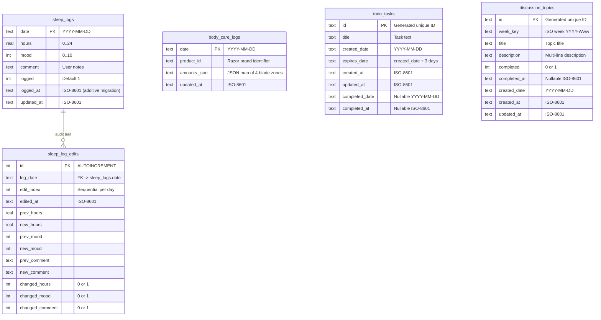

# Simple Sleep Journal — Complete Technical Documentation & Architecture Reference

This document is the authoritative engineering reference for `simple-sleep-journal` (`v1.2.0`). It explains **what** lives where, **how** each subsystem works, and **why** every architectural, performance, gesture, animation, storage, and build decision was made. Because source files under `src/` are kept free of inline comments, all design rationale and invariant explanations live here.

---

## 1. Tech Stack & Runtime Dependencies

| Layer | Technology | Version / Configuration | Purpose |
| --- | --- | --- | --- |
| Framework | Expo SDK / React Native | `^58.0.26` / `0.88.1` (New Architecture + Hermes) | Cross-platform Android & iOS runtime |
| Gestures | `react-native-gesture-handler` | `~3.3.0` (pinned to Expo SDK 58 bundled native module) | Native UI-thread horizontal panning in `SmoothHorizontalPager` |
| Native Compose UI | `@expo/ui` | `~58.0.29` | Jetpack Compose `DateRangePickerDialog` for export range selection |
| Navigation | Expo Router | `~58.0.32` | File-system-based root & tab routing |
| Horizontal Paging | Custom `SmoothHorizontalPager` | `PanGestureHandler` + native `Animated.event` & `Animated.spring` | 120fps UI-thread horizontal paging immune to Compose `uiMode` and `ScrollView` snap bugs |
| Database | `expo-sqlite` | `~58.0.18` | Local relational SQLite storage (`sleepinapp.db`) with atomic transactions |
| Preferences | `@react-native-async-storage/async-storage` | `2.2.0` | User settings (`sleepinapp.settings`) and per-mode appearance persistence |
| File Storage & SAF | `expo-file-system` & `@react-native-documents/picker` | `~58.0.14` / `^12.0.3` | 4-tier Android Scoped Storage (SAF) export & native URI import |
| Images | `expo-image` & `expo-image-manipulator` | `~58.0.18` / `~58.0.16` | Hardware-cached screen wallpapers and JPEG compression (`1080px`, `0.75`) |
| Vector Graphics | `react-native-svg` | `^15.16.0` | Memoized animated dotted focus borders |
| Typography | Redaction Font Family + `expo-font` | `~58.0.12` | Degraded serif bitmap typography plus custom `.ttf`/`.otf` loading |
| Language | TypeScript | `~6.0.3` | Strict static typing (`npm run typecheck`) |
| Testing | Node.js Test Runner (`node:test`) | Native Type Stripping | Fast pure-logic unit suite (`102` tests across `15` suites) |

---

## 2. Repository Structure & Module Map

```
simple-sleep-journal/
├── app.json                               # Expo config (production default: @shittyassapps/sleepinapp, v1.2.0, versionCode 8)
├── eas.json                               # EAS Build config (appVersionSource: remote, autoIncrement: true, APK output)
├── plugins/
│   └── with-agp9-compat.js                # Expo Config Plugin injecting AGP 9 compatibility into generated android/ on EAS Cloud
├── themes/
│   ├── default.json                       # Canonical monochrome vanilla theme template
│   └── TUTORIAL.md                        # Authoring guide for custom themes/*.json and *.moodtheme files
├── scripts/
│   ├── build-wizard.mjs                   # Interactive & headless CLI build configurator (default / baked / dynamic)
│   ├── wizard-themes.mjs                  # Dynamic themes/ folder scanner & wallpaper path/dataUri resolver
│   └── install-all.sh                     # Side-by-side ADB installer for local dev APKs
├── assets/
│   ├── fonts/                             # Bundled Redaction OTF weights, Comic Sans, and assets/fonts/custom/
│   └── images/                            # App icons, splash, wallpapers, and optional self-harm tracker blade assets
├── src/
│   ├── app/
│   │   ├── _layout.tsx                    # Root GestureHandlerRootView, providers, font preloading, native chrome setup
│   │   └── (tabs)/
│   │       ├── _layout.tsx                # Spring-animated 2- or 3-tab horizontal container, screen wallpapers, root ToastHost
│   │       ├── index.tsx                  # Calendar entry route
│   │       └── settings.tsx               # Settings entry route
│   ├── components/
│   │   ├── animated-dotted-border/        # Memoized 2-layer SVG marching-dash focus border
│   │   ├── animated-radio-dot/            # Native-driver spring radio indicator matching Ionicons geometry
│   │   ├── calendar-grid/                 # Monthly calendar pager, year/month header sync, day cells
│   │   ├── color-picker/                  # Interactive HSV plane, hue slider, hex input color picker
│   │   ├── confirm-dialog/                # Themed modal confirmation dialog
│   │   ├── icons/                         # Reusable custom vector/View icons (ReadingModeMobileIcon)
│   │   ├── nav-bar/                       # Spring-animated floating bottom navigation bar (2 or 3 tabs)
│   │   ├── settings/                      # Settings screen, Appearance Studio, export/import dialogs, native date range picker
│   │   ├── sleep-modal/                   # Daily entry sheet, isolated expandable comment editor, to-do list, optional self-harm tracker
│   │   ├── smooth-pager/                  # Native UI-thread windowed horizontal pager
│   │   ├── to-discuss/                    # Weekly Recaps (Half/Quarter/Month zoomable view + WeekDiscussModal)
│   │   ├── top-toast/                     # Multi-host slide-down status toast & safe-area alignment
│   │   └── wheel-picker/                  # Animated + PanResponder cyclical vertical wheel picker
│   ├── constants/
│   │   ├── build-config.json              # Build-time generated configuration written by scripts/build-wizard.mjs
│   │   ├── build-config.ts                # Typed build-config loader merging defaults safely
│   │   ├── default-theme.ts               # Canonical light/dark BASE_PALETTE, DEFAULT_FEATURE_FLAGS, DEFAULT_THEME
│   │   ├── grid.ts                        # Calendar grid dimension steps and bijections
│   │   └── theme.ts                       # Legacy color helper bridge
│   ├── contexts/
│   │   ├── appearance-context.tsx         # Active theme, palette overrides, 3 screen wallpapers, fonts, .moodtheme export/import
│   │   ├── nav-direction-context.tsx      # Active tab state shared between TabsLayout and NavBar
│   │   ├── nav-utils.ts                   # Tab visibility, index math, swipe stepping, safe-area nav bar clearance
│   │   ├── settings-context.tsx           # Persisted grid step, color scheme preference, Weekly Recaps toggle
│   │   └── toast-context.tsx              # Multi-host toast routing and root top inset propagation
│   ├── hooks/
│   │   ├── color-scheme.utils.ts          # Locked light/dark vs automatic color scheme resolution
│   │   ├── use-app-color-scheme.ts        # Hook binding SettingsContext scheme pref to React Native Appearance
│   │   └── use-header-width-sync.ts       # Offscreen label measurement & centered animated header window
│   ├── lib/
│   │   ├── db.ts                          # SQLite singleton, serialized operation queue, schema migration, CRUD & atomic restore
│   │   ├── db-import.utils.ts             # Backup table clear order, multi-version payload parser, row sanitizers
│   │   ├── editor-utils.ts                # Double-tap window, tap-outside movement threshold, dynamic expandable box heights
│   │   ├── export-utils.ts                # TXT, CSV (RFC 4180), JSON (v1.3.0) formatters and UTC date range utilities
│   │   ├── file-saver.ts                  # 4-tier Android SAF export pipeline and native URI file reader
│   │   └── theme-utils.ts                 # Effective color resolution, .moodtheme serialization/validation, baseline diffing
│   └── types/
│       └── appearance.ts                  # Core TypeScript types for modes, palettes, backgrounds, features, build config
└── tests/                                 # Native Node.js unit test suites (15 files, 102 tests)
```

---

## 3. Database Architecture, Upgrade Safety & Backup Compatibility

### 3.1 Relational Schema (`sleepinapp.db`)



### 3.2 Why SQLite Access Uses a Serialized Queue & Auto-Recovery (`src/lib/db.ts`)
- **Single Serialized Queue (`enqueue` / `withDb`)**: All database calls chain through a single promise queue (`opQueue`) so overlapping UI mounts (e.g., `CalendarGrid`, `ToDiscuss`, and `SleepModal` initializing concurrently) never collide on SQLite transactions or race `ensureSchema`.
- **Native Handle Recovery (`withDbInner`)**: On Android, Expo's `NativeDatabase` handle can occasionally report `already released` after OS background reclamation or fast reload. Catching that signature resets `dbInstance`/`dbPromise`, opens a fresh handle via `openFreshDb()`, and transparently retries the operation once.
- **Immediate Schema Guard in `openFreshDb()`**: Calling `await ensureSchema(db)` inside `openFreshDb()` ensures any screen querying `todo_tasks` or `discussion_topics` on first launch after upgrading from `v1.1.2` can never hit a missing-table error even if it runs before an explicit `initDB()` call completes.

### 3.3 Production In-Place Upgrade Safety (`v1.1.2` -> `v1.2.0`)
Upgrading an installed production build (`@shittyassapps/sleepinapp`, `v1.1.2`, `versionCode 7`, SDK 57) directly to `v1.2.0` (`versionCode 8`, SDK 58) preserves 100% of user data because:
1. **Identical Android Application Identity**: `android.package` stays `com.shittyassapps.sleepinapp`, EAS project identity stays `335d449a-1d0e-418c-a6d5-a332a13b67b1` (`owner: "shittyassapps"`, `slug: "sleepinapp"`), scheme stays `sleepinapp`, and `versionCode` strictly increases (`7 -> 8`, managed remotely via `eas.json` `appVersionSource: "remote"` + `autoIncrement: true`).
2. **Identical Database Filename & Strictly Additive Schema**: `openDatabaseAsync("sleepinapp.db")` opens the exact existing SQLite file. `ensureSchema()` exclusively runs `CREATE TABLE IF NOT EXISTS`, `CREATE INDEX IF NOT EXISTS`, and guarded `ALTER TABLE sleep_logs ADD COLUMN logged_at TEXT` (checked via `PRAGMA table_info`). No `DROP TABLE` or startup `DELETE` exists anywhere in `db.ts`.
3. **Backward-Compatible `AsyncStorage` Keys**: `SettingsProvider` continues reading `"sleepinapp.settings"`. Legacy keys (`stepIndex`) cleanly migrate into `stepIndexNarrow`/`stepIndexWide`, `colorSchemePref` is preserved verbatim, and the new `toDiscussEnabled` flag defaults gracefully to `true` when absent. `AppearanceProvider` uses its own scoped key (`sleepinapp.appearance_${mode}_v4`), never colliding with `sleepinapp.settings`.

### 3.4 Backward-Compatible Backup Import & Export (`db-import.utils.ts`, `export-utils.ts`, `file-saver.ts`)
- **Supported Import Formats (`parseBackupJsonPayload`)**:
  - **v1.0 legacy flat array**: `[{ date, hours, mood, comment }]` -> routed to `importLogs()` via `sanitizeImportedSleepLogs()` (preserving `logged_at`/`updated_at` if present, normalizing `null`/`undefined` comments to `""`, clamping numeric ranges, skipping malformed rows).
  - **v1.1.2 production backup (`version: 3`)**: `{ version: 3, logs, edits, bodyCareLogs }` -> routed to `importBackup()`, defaulting absent `todos` and `discussionTopics` to `[]` without error.
  - **v1.2.x & v1.3.0 backups**: `{ export_date, version: "1.3.0", logs, edits, bodyCareLogs, todos, discussionTopics }` as well as partial backups containing only `bodyCareLogs`, `todos`, or `discussionTopics`.
- **Sanitizers (`sanitizeImportedSleepLogs`, `sanitizeImportedSleepLogEdits`, `sanitizeImportedBodyCareLogs`, `sanitizeImportedTodos`, `sanitizeImportedDiscussionTopics`)**:
  - Guard every field before SQLite binding: accepts both boolean and `0`/`1` flags for `changed_*`, accepts either object `amounts` or raw stringified `amounts_json` for self-harm records, inserts all sanitized edit rows directly inside the transaction so history is never dropped, and silently skips corrupt records without aborting valid rows.
- **Atomic Wipe-Before-Restore (`CLEAR_ALL_DATA_SQL`)**:
  - Both `importLogs` and `importBackup` run inside a single `db.withTransactionAsync(...)` clearing all 5 user tables (`sleep_log_edits`, `body_care_logs`, `todo_tasks`, `discussion_topics`, `sleep_logs`) before re-inserting imported records. If anything fails, SQLite rolls back the entire transaction; if it succeeds, no stale ghost entries from previous device state survive.
- **Export Formats (`export-utils.ts`)**:
  - **JSON (`v1.3.0`)**: Full structured backup (`logs`, `edits`, `bodyCareLogs` when enabled, `todos`, `discussionTopics`).
  - **CSV (RFC 4180)**: Unified 35-column table (`record_type` = `log` | `edit` | `self_harm` | `todo` | `discussion`) with full double-quote escaping (`csvEscapeCell`).
  - **TXT**: Human-readable chronological journal report interleaving weekly recap blocks at week boundaries (`endDateStr`), day edit trails, and task lifecycle blocks (added, completed, expired).
  - **Date Range Picker UTC Helpers (`isoDateToUtcMidnightIso`, `utcDateToIsoDate`)**: Material 3's `DateRangePickerDialog` represents calendar selections at UTC midnight regardless of device timezone; converting strictly in UTC guarantees dates never shift by +/-1 day across timezones.
- **4-Tier Android SAF Export & Native Reading (`file-saver.ts`)**:
  - Android `content://` URIs fail under OkHttp's `fetch()`. `readTextFileFromUri()` reads directly through `expo-file-system/legacy`'s `readAsStringAsync` (`ContentResolver.openInputStream`).
  - `saveFileToDevice()` tries: (1) `@react-native-documents/picker` SAF directory/document saver, (2) remembered SAF folder URI via `StorageAccessFramework`, (3) interactive `requestDirectoryPermissionsAsync()`, and (4) `expo-sharing` share sheet fallback.

---

## 4. Core UI & Gesture Engine Decisions

### 4.1 `SmoothHorizontalPager` (`src/components/smooth-pager/`)
**Why we built a custom horizontal pager instead of `react-native-pager-view` or `<ScrollView horizontal pagingEnabled>`**:
1. `react-native-pager-view@9.0.7` (`ComposePagerView` / Jetpack Compose `HorizontalPager`) permanently breaks its settle/fling physics on Android after an OS-level `uiMode` dark/light transition, stalling mid-swipe for ~350ms before teleporting. It has been removed completely from both `src/` and `package.json`.
2. `<ScrollView horizontal pagingEnabled>` routes finger releases through Android `OverScroller`/`smoothScrollTo`, discarding release momentum into an abrupt ~250ms snap and forcing `flexGrow: 1` height expansion that distorted centered grids.
3. **`SmoothHorizontalPager` Architecture**:
   - Uses `<PanGestureHandler maxPointers={1} activeOffsetX={[-10, 10]} failOffsetY={[-20, 20]}>` (allowing vertical `ScrollView`s and 2-finger pinch gestures to pass through untouched) bound directly to native-driver `Animated.event([{ nativeEvent: { translationX: dragX } }], { useNativeDriver: true })`.
   - On release (`State.END`), `resolveSwipeTargetPage` blends horizontal displacement (`>= 32%` of page width) and release velocity (`velocityX` clamped via `clampSpringVelocity`) so short flicks commit immediately, while long drags past half a page settle cleanly without overshooting.
   - Settle physics run on the native UI thread via `Animated.spring` (`stiffness: 320, damping: 32, mass: 0.85, overshootClamping: true`) carrying real finger velocity in `dp/s`, and grabbing mid-flight (`State.BEGAN`) calls `baseTx.stopAnimation` so consecutive swipes never wait for settle completion.
   - **Immediate Header Feedback on Release**: At `State.END`, `emitPageScroll` notifies peer pagers (year/month headers) immediately instead of waiting ~250ms for the spring to come to rest.
   - **Windowed Rendering & Zero-Lag Year Jumps (`smooth-horizontal-pager.utils.ts`)**:
     - `getVisiblePagerIndices` mounts only `[center - windowRadius .. center + windowRadius]` plus optional `extraOffsets` (e.g., `[-12, 12]` for instant +/-1 year jumps in `CalendarGrid` and `Month` view, `[-4, 4]` in `Quarter` view).
     - `getWindowShiftThreshold` applies hysteresis (`2` when `windowRadius >= 3`) so single-page swipes mount/unmount zero views mid-drag.
     - `setPageWithoutAnimation` avoids blank black flashes on uncached multi-year jumps by keeping the current page in `retainedPages` while mounting the offscreen target across `2x rAF`, and defers `windowCenter` rebuilds by `WINDOW_SHIFT_SETTLE_DELAY_MS = 260ms` (flushed early on `State.BEGAN`) so year swipes stay locked at 120fps.
     - `applyHorizontalRubberBand` damps drags past track bounds (`[minTx, maxTx]`) by `0.25x`.

### 4.2 `CalendarGrid` & Synchronized Headers (`src/components/calendar-grid/`, `src/hooks/use-header-width-sync.ts`)
- **Synchronized 3-Pager Architecture**: Year (`windowRadius = YEAR_RANGE`, all 11 years preloaded), Month (`windowRadius = 12`), and Grid (`windowRadius = 2` + `extraOffsets = [-12, 12]`) share a unified scroll coordinator (`calendar-grid.utils.ts`).
- **Swipe Direction & Reversal Hysteresis (`getDragPreviewPage`, `SWIPE_TRIGGER_THRESHOLD`, `SWIPE_RETURN_THRESHOLD`)**: Measuring swipe thresholds from `dragStartPosRef` prevents accidental skips during mid-settle grabs, while center-return hysteresis ensures reversing a drag across center cleanly restores `anchorPage` instead of jumping across months. `isScrollSettled` and `resolveCanceledSwipePage` guard against premature idle callbacks before snap completion.
- **Centered Dynamic Header Window (`useHeaderWidthSync`)**: Offscreen hidden measurement containers compute exact rendered widths for all 12 month labels and 11 year labels, animating a centered clipping window so `<` `>` chevrons hug the active label tightly without clipping. `yearHeader` passes `minWidthDelta: 6` so tiny ~2–3dp width differences between digits (e.g., `2026` vs `2027`) skip unnecessary 260ms layout animations during year swipes.
- **Responsive Cell Geometry (`calendar-grid.utils.ts`)**: `getGridRowHeight` clamps row height to `[46, 90]`, and `GRID_STEPS` defines 5 fixed configurations (`4x8`, `5x7`, `6x6`, `7x5`, `8x4`, each yielding 32–36 cells) with inverse bijections `columnsPageForStep` / `columnsStepForPage`.

### 4.3 `ToDiscuss` / Weekly Recaps Multi-Zoom Engine (`src/components/to-discuss/`)
- **ISO-8601 Week Math (`to-discuss.utils.ts`)**:
  - Uses UTC calendar math (`getIsoWeekFromDate`) to eliminate DST boundary errors.
  - December 28 always falls inside the final ISO week of its own ISO week-year (`52` or `53`).
  - **Half-Year**: H1 displays weeks `1..28`; H2 displays weeks `28..end` padded with next year's weeks `1, 2`.
  - **Quarter**: Groups ISO weeks into 3 calendar month columns (`getQuarterMonthColumns`), with non-breaking space padding around italic month headers to prevent glyph clipping on Android.
  - **Month (ISO Thursday Rule)**: Every ISO week belongs to the calendar month containing its Thursday (`>= 4` days in that month), guaranteeing strictly 4 or 5 distinct weeks per month with zero cross-month duplicates. Layout uses a 2x2 grid (4 weeks) or symmetric 2x2 + centered 5th quincunx (`getMonthQuincunxLayout`); 13- or 14-week quarters also have geometric star coordinate helpers.
- **Two-Stage Continuous Pinching (`evaluatePinchZoomStep`)**:
  - `zoomClipViewport` intercepts multi-touch events via capture handlers (`onTouchStartCapture`/`MoveCapture`/`EndCapture`) so child `Pressable`s or horizontal pagers never swallow 2-finger pinches, and orphaned pinch locks clear automatically if an unmounted child drops `touchEnd`.
  - **Stage 0 (initial pinch)**: Deliberate responsive threshold (`1.24x` / `0.80x` ratio, `36–62dp` delta) with live finger tracking (`0.78x` in `[0.82, 1.2]`) and subtle boundary rubber-banding (`0.18x` in `[0.95, 1.05]`).
  - **Stage 1+ (continuous 2-stage skip without lifting fingers, e.g. `half -> quarter -> month`)**: While 2 fingers stay down after Stage 1 settles, `ToDiscuss` defers remounting the underlying pager so Android's `JSTouchDispatcher` never loses its touch target, routes continuous tracking (`0.38x` in `[0.82, 1.22]`) to the settled Stage-1 overlay, and requires a deliberate continuation in the same direction (`+95dp & >= 1.38x` in, `-85dp & <= 0.66x` out) so normal pinches never accidentally skip `quarter`.
  - **Cooldown Rule (`shouldApplyPinchCooldown`)**: Applies a short `90ms` post-pinch swipe guard only when a pinch is aborted without changing zoom level; completed zoom transitions immediately release scroll locks so swiping works right away.
- **Zero-Snap, Zero-Flash, Alternating 2-Slot Zoom Architecture (`to-discuss.tsx`)**:
  - **Why previous single-value approaches flickered**: Mutating `pinchScaleAnim.setValue(1)` or shared `outgoingOpacityAnim.setValue(1)` synchronously inside `changeZoomLevel` flushed to Android's native UI thread 1–2 frames *before* React committed updated style bindings — causing both a 1–2 frame scale snap (`1.20x -> 1.00x`) on the old view and a 1-frame flash of the Stage-0 grid between Stage 1 and Stage 2.
  - **How the current architecture eliminates every race mathematically**:
    1. Base grid `<Animated.View key={pagerZoomLevel}>` binds unconditionally to `baseGridOpacityAnim` and `allGridScale = gridScaleAnim * pinchScaleAnim * baseOutgoingScaleAnim` (never swapping scale/opacity nodes).
    2. Transition overlays alternate across two fully isolated slots `overlaySlots[0 | 1]` (`slot = id % 2`), each owning independent `{ opacity, enterScale, exitScale, settledScale = pinchScaleAnim * exitScale }`.
    3. On pinch triggers (both Stage 1 on base grid and Stage 2 on settled overlay), `pinchScaleAnim` is **never reset before React commits**; instead, the relative multiplier (`baseOutgoingScaleAnim` or `prevSlot.exitScale`) animates smoothly from `1.0 -> outEndScale / fromScale` (`165ms`, `Easing.out(quad)`) while opacity fades `1 -> 0` (`110ms`, `Easing.out(quad)`).
    4. Incoming mounts in the opposite unused slot with `staticOverlay` (`<View>` cells instead of interactive `Pressable` trees), waits `1x rAF` + `15ms`, and glides in (`0.94`/`1.06 -> 1.0` in `210ms` via `Easing.bezier(0.22, 1, 0.36, 1)`, opacity `0 -> 1` in `170ms`).
    5. Cleanup is strictly split into `cancelIncomingTimers` (run on effect cleanup) and `cancelOutgoingAnim` (run only on new transition, `syncPagers`, or unmount) so rapid button presses never cancel the newly started outgoing fade. Mid-flight interrupts animate the previous slot directly from its current `enterScale` and `opacity` to `outEndScale` and `0` while hiding `baseGridOpacityAnim` at `0`.
    6. `pinchScaleAnim` and `baseOutgoingScaleAnim` reset to `1` only inside the `inAnim` completion callback (~`130ms` after outgoing already reached `opacity: 0`), aligning `settledScale (1.0)` identically with `enterScale (1.0)`.
    7. **Wallpaper-Aware Post-Commit Handoff**: When no Weekly Recaps wallpaper is set, the settled incoming cover uses `backgroundColor: colors.background` while the freshly mounted target pager pre-reveals behind it for `1x rAF` (`handoffRafRef`). When `backgrounds.toDiscuss` is active, the cover stays transparent so no solid rectangle ever obscures the photo, and `baseGridOpacityAnim` swaps atomically inside `handoffRafRef`.
    8. **Progressive Neighbor Hydration (`zoomHydrationStage: 0 | 1 | 2`)**: Keeps `windowRadius = 0` during zoom, immediately opens `±1` (`stage = 1`) after handoff so horizontal swiping works immediately without stalling Fabric, and warms `±2` + `extraOffsets` (`stage = 2`) after `220ms` idle.
    9. Header indicators (`halfAnim`, `quarterAnims`) snap directly at Frame 0 so zero concurrent springs compete with the zoom transition, while `headerSlot` runs a directional opacity/scale transition (`headerOpacityAnim`, `headerScaleAnim`).

### 4.4 `SleepModal` & `WeekDiscussModal` Editing UX
- **Unified Bottom-Sheet Geometry**: Both sheets share identical top corner radius (`28`), `maxHeight: "88%"`, backdrop (`colors.modalOverlay`), `185ms` cubic ease-out open timing (`Easing.out(Easing.cubic)`, replacing the older >1s underdamped spring in `SleepModal`), and identical drag handle (`70x6`, `borderRadius: 3`, `#B0B0B0`, `paddingTop: 16`, `paddingBottom: 12`, generous `hitSlop`).
- **Scrollable Read Mode + Double-Tap Edit + Tap-Outside Exit (`editor-utils.ts`)**:
  - Both `SleepModalCommentSection` and `WeekDiscussModal` topic descriptions default to scrollable read mode (`<ScrollView nestedScrollEnabled>` wrapping a full-area `<Pressable>`), preventing accidental keyboard popups while scrolling long entries.
  - Consecutive taps within `DOUBLE_TAP_DELAY_MS = 320ms` (`isDoubleTap`) enter edit mode (in `WeekDiscussModal`, focusing `editDescInputRef` directly while the pencil icon `edit-2` focuses `DynamicTitleInput`).
  - Tapping outside the active editor (displacement `<= 12px` via `isTapMovementWithinThreshold`, tracked via non-interfering `onTouchStartCapture` / `onTouchStart` / `onTouchEnd` so `ScrollView` and `PanResponder` are never blocked), tapping `checkmark`, or hiding the keyboard cleanly commits/exits edit mode without clobbering focus when switching straight into another input.
- **Dynamic Content-Aware Expansion (`computeDynamicBoxHeight`)**:
  - Both modals provide a `Feather` `maximize` / `minimize` toggle (left of centered `comment` in `SleepModal`; between `swap-horizontal` move and `edit-2` edit in `WeekDiscussModal`, plus during edit/add).
  - Toggling `maximize` always switches state and icon (`maximize <-> minimize`), but box height is driven dynamically by measured text height (`<Text onLayout>` + padding in read mode, `<TextInput onContentSizeChange>` in edit mode) clamped via `computeDynamicBoxHeight`:
    - `SleepModal`: `116..240dp` collapsed, dynamically growing up to **`480dp`** (`2x` cap) when expanded.
    - `WeekDiscussModal`: `57..129dp` collapsed, dynamically growing up to **`413dp`** (`~3.2x` cap) when expanded.
  - Short or empty notes stay compact instead of inflating empty whitespace, grow smoothly (`110ms`) line-by-line while typing past the collapsed cap up to the expanded cap, and animate smoothly (`200ms`) when toggling `maximize` <-> `minimize` on long notes.
- **Zero-Lost-Click Opening in `SleepModal`**:
  - `SleepModal` reserves exact `WheelPicker` space (`hoursPlaceholder: { height: 112 }`) while `readyHours === null` so comment header icons never shift vertically mid-open.
  - Resets `SleepModalCommentSection` synchronously on modal open via `openSessionKey` rather than waiting for async SQLite `loadExisting()` (`pagerKey`); when `initialComment` arrives asynchronously, it populates `draft` only if `!userDirtyRef.current` without wiping early taps on `edit-2` or `maximize`.
  - Header action buttons use full `40x34` touch boxes inside `commentSection` so Android never clips `hitSlop` at parent boundaries.
- **Isolated Comment Subtree & Memoized SVG Focus Border (`animated-dotted-border.tsx`)**:
  - `SleepModalCommentSection` is `React.memo`-isolated with local `draft` state forwarding changes into `SleepModal`'s `stateRef.current.comment` via a stable ref callback, so typing long notes never re-renders the parent modal.
  - `DottedBorderSvgOverlay` is memoized on primitive box dimensions (`width`, `height`) and theme colors, keeping its 2-layer dashed SVG marching loop running continuously while typing.
- **Daily To-Do List (`todo-list-section.tsx`, `todo.utils.ts`)**:
  - Tasks stay visible from `created_date` through `expires_date = created_date + 3 days` (`TODO_CARRYOVER_DAYS = 3`, UTC DST-safe math via `addDaysToIsoDate`). Completed tasks remain visible through `completed_date` and hide on subsequent days. Elapsed hours format as `(<1 hours ago)`, `(N hours ago)`, or `(>96 hours ago)`.
- **`WheelPicker` (`src/components/wheel-picker/`)**:
  - Built on `Animated` + `PanResponder` with windowed rendering (`getVisibleWheelIndices`), velocity flick projection (`projectWheelReleasePage` adding momentum only for deliberate flicks), soft boundary rubber-banding (`computeRubberBandWheelPage`), and parent `ScrollView` lock handoff (`onScrollStateChanged`).

### 4.5 `TopToast`, `NavBar`, `AnimatedRadioDot`, `ReadingModeMobileIcon` & `NativeDateRangePicker`
- **Multi-Host `TopToast` (`top-toast.tsx`, `toast-context.tsx`)**: Root `<ToastHost hostId="root" />` stays permanently mounted in `(tabs)/_layout.tsx` (avoiding Fabric native-driver attachment races on fresh mounts) and publishes its measured `insets.top` (`rootTopInset`) so in-modal hosts (`sleep-modal`, `week-modal`, `settings-studio`) align identically via `resolveToastTopOffset` even when Android translucent `<Modal>` views report `insets.top = 0`. Sheet-closing toasts (`saved`, `entry deleted`, `week deleted`) fire on the next animation frame after `onClose()` so a single clean slide-down animation plays on `"root"`.
- **`SettingsProvider` Night-Mode Guard (`settings-context.tsx`)**: When the user locks `light` or `dark` mode, `AppState` and `Appearance` listeners re-assert `Appearance.setColorScheme(getNativeAppearanceOverride(colorSchemePref))` if Android OS `uiMode` toggles while active.
- **`AnimatedRadioDot` (`animated-radio-dot.tsx`, `radio-dot.utils.ts`)**: Native-driver spring dot pop with proportional circle geometry (`getRadioDotMetrics`) matching Ionicons radio-button proportions.
- **`ReadingModeMobileIcon` (`src/components/icons/reading-mode-mobile-icon.tsx`)**: Pure React Native `View` implementation matching Fluent UI `reading-mode-mobile-24-o` / `-24-f` proportions (16x20 rounded card + 3 rounded lines) stored in the dedicated `src/components/icons/` folder.
- **`NativeDateRangePicker` (`src/components/settings/native-date-range-picker.tsx`)**: Runtime capability check (`UIManager.getViewManagerConfig` / `ExpoUI` guard) lazily loads `@expo/ui/jetpack-compose` `DateRangePickerDialog` only when the native binary includes it, falling back gracefully to manual date inputs on older binaries or non-Android platforms.

---

## 5. Modular Appearance System, `themes/` & Build Wizard

### 5.1 Three Distribution Modes (`BuildMode`)
1. **`default`**: Clean monochrome Redaction theme, Appearance Studio hidden, `.moodtheme` export disabled (import remains allowed), reset restores vanilla defaults. **This is the canonical production release mode for `@shittyassapps/sleepinapp`.**
2. **`baked`**: Compile-time custom palette, font, 3 screen wallpapers (`calendar`, `toDiscuss`, `settings`), app name, icon, and feature flags baked into `src/constants/build-config.json`. Reset restores the baked baseline.
3. **`dynamic`**: Unlocks Appearance Studio (magic wand in Settings) for live HSV/Hex color editing, custom `.ttf`/`.otf` font loading, separate wallpapers for Calendar, Weekly Recaps, and Settings, runtime feature flags, and `.moodtheme` export/import.

### 5.2 External `themes/` Directory & `scripts/build-wizard.mjs`
- Hardcoded preset palettes were removed from `scripts/build-wizard.mjs`.
- `scripts/wizard-themes.mjs` dynamically scans top-level `themes/` for any `.json` or `.moodtheme` file (`default.json` listed first, all user themes sorted alphabetically).
- Full theme authoring instructions, schema reference, and CLI override examples live in [themes/TUTORIAL.md](themes/TUTORIAL.md).
- Supported background flags in `build-wizard.mjs`:
  - `--calendar-bg=<path|none>` (`--calendarBg`)
  - `--weekly-recaps-bg=<path|none>` (`--weeklyRecapsBg`, `--to-discuss-bg`, `--toDiscussBg`)
  - `--settings-bg=<path|none>` (`--settingsBg`)
- For the production package `com.shittyassapps.sleepinapp`, `build-wizard.mjs` preserves the canonical deep-link scheme `"sleepinapp"`.

---

## 6. Expo / EAS Production Configuration & Local Multi-APK Builds

### 6.1 EAS Cloud Prebuild Compatibility (`plugins/with-agp9-compat.js`)
Because `/android` is gitignored, EAS Cloud runs `expo prebuild --platform android` cleanly from `app.json` and `package.json`. On Expo SDK 58 (Gradle 9 / AGP 9), `@react-native-async-storage/async-storage@2.2.0` fails to compile its optional Room `next/*.kt` sources under AGP 9's built-in Kotlin plugin unless excluded, and legacy Expo Gradle modules require `android.newDsl=false`.

`plugins/with-agp9-compat.js` (registered in `app.json` under `expo.plugins`) applies both fixes idempotently during every `expo prebuild` (both locally and on Expo Dev Cloud):
1. Ensures `android.newDsl=false` in `android/gradle.properties`.
2. Appends the `react-native-async-storage_async-storage` `**/next/**` exclusion block to `android/build.gradle`.

### 6.2 Production Release Configuration (`@shittyassapps/sleepinapp`)
- **Expo Project**: `@shittyassapps/sleepinapp`, Project ID `335d449a-1d0e-418c-a6d5-a332a13b67b1`, owner `shittyassapps`, slug `sleepinapp`.
- **App Identity**: `name: "mood journal"`, `android.package: "com.shittyassapps.sleepinapp"`, `ios.bundleIdentifier: "com.shittyassapps.sleepinapp"`, `scheme: "sleepinapp"`, vanilla `icon: "./assets/images/icon.png"`.
- **Versioning**: `version: "1.2.0"`, `android.versionCode: 8` (following previous production `1.1.2` / `versionCode 7`); `eas.json` sets `appVersionSource: "remote"`, `autoIncrement: true`, and `build.production.android.buildType: "apk"`.
- **Build Mode**: `src/constants/build-config.json` stays configured in `default` mode (`bodyCareEnabled: false`, `inAppCustomizationEnabled: false`).

Triggering an EAS Cloud production APK build:
```bash
eas build --platform android --profile production
```

### 6.3 Verification & Local Side-by-Side Dev APK Workflow
```bash
# Static TypeScript verification (0 errors)
npm run typecheck

# Native Node.js unit test runner (15 suites, 102 tests)
npm test
```

Test suites under `tests/`:
- `animated-radio-dot.test.ts` — Radio dot sizing and clamping
- `appearance.test.ts` — Theme resolution, `.moodtheme` serialization/validation (including Weekly Recaps wallpaper), mode rules, baseline reset detection
- `body-care.test.ts` — Self-harm quadrant totals and resilient JSON parsing
- `calendar-grid.styles.test.ts` — Row clamping, responsive font/cell widths, semantic day tokens
- `calendar-grid.utils.test.ts` — Leap years, month grouping, swipe thresholds, reversal center band, settlement guards
- `db-import.test.ts` — Atomic clear order, v1.0 / v1.1.2 / v1.3.0 backup parsing & sanitization, additive schema upgrade verification
- `editor-utils.test.ts` — Double-tap window, tap-outside movement threshold, 2x / 3.2x bounds, dynamic content-aware heights
- `export-helpers.test.ts` — CSV escaping, TXT/CSV/JSON export payloads, weekly recap blocks, UTC date picker roundtrips
- `nav-and-theme.test.ts` — Color scheme locking, 2-tab/3-tab navigation math, inset clearances
- `settings-grid.test.ts` — Grid step bijections and bounds clamping
- `smooth-horizontal-pager.test.ts` — Index clamping, windowed slots, `extraOffsets`, window shift hysteresis, rubber-banding, swipe target velocity blending
- `to-discuss.utils.test.ts` — ISO-8601 week math (including 53-week years), Half/Quarter/Month layouts, Thursday rule, carry-over targeting, pinch cooldown & two-stage zoom thresholds
- `todo.utils.test.ts` — 3-day carry-over visibility, chronological sorting, elapsed hours, backup sanitization
- `wheel-and-toast.test.ts` — Wheel physics, toast handoff state machine, safe-area top offset alignment, sleep dirty snapshot checks
- `wizard-themes.test.ts` — Top-level `themes/` directory discovery, `.json` / `.moodtheme` parsing, wallpaper spec resolution

Local 3-APK dev installation (safe CPU/memory budget, then restore repo to production `default`):
```bash
export JAVA_HOME=/usr/lib/jvm/java-21-openjdk-amd64
export ANDROID_HOME=$HOME/Android/Sdk

# 1. Default dev APK
node scripts/build-wizard.mjs --mode=default --name="mood journal (default)" --packageId="com.shittyassapps.sleepinapp.default" --bodyCare=false
(cd android && taskset -c 0-2 ./gradlew assembleRelease --no-parallel --max-workers=1 -PreactNativeArchitectures=arm64-v8a)
cp -f android/app/build/outputs/apk/release/app-release.apk apks/mood-journal-default.apk

# 2. Dynamic dev APK
node scripts/build-wizard.mjs --mode=dynamic --name="mood journal (dynamic)" --packageId="com.shittyassapps.sleepinapp.dynamic" --bodyCare=true
(cd android && taskset -c 0-2 ./gradlew assembleRelease --no-parallel --max-workers=1 -PreactNativeArchitectures=arm64-v8a)
cp -f android/app/build/outputs/apk/release/app-release.apk apks/mood-journal-dynamic.apk

# 3. Baked dev APK
node scripts/build-wizard.mjs --mode=baked --name="mood journal (baked)" --packageId="com.shittyassapps.sleepinapp.baked" --bodyCare=false --theme=custom --bg="#1E0538" --text="#FFE600" --element="#6B1D99" --selected="#00FF99" --secondary="#FF70C5" --light-bg="#FFF5FA" --light-text="#5A009D" --light-element="#FFE0F0" --light-selected="#00E5FF" --light-secondary="#FF1493" --font-name=ComicSans --calendar-bg="assets/images/custom-cat-bg.png" --weekly-recaps-bg="assets/images/custom-cat-bg.png" --settings-bg=none --icon="assets/images/cat-icon.png"
(cd android && taskset -c 0-2 ./gradlew assembleRelease --no-parallel --max-workers=1 -PreactNativeArchitectures=arm64-v8a)
cp -f android/app/build/outputs/apk/release/app-release.apk apks/mood-journal-baked.apk

# 4. Install all 3 side-by-side over USB
./scripts/install-all.sh

# 5. Restore repo cleanly to production default configuration for EAS Cloud
node scripts/build-wizard.mjs --mode=default --name="mood journal" --packageId="com.shittyassapps.sleepinapp" --bodyCare=false
```

---

## 7. License

`simple-sleep-journal` is licensed under a Personal and Non-Commercial License (see [LICENSE](LICENSE)):
- Personal use and modification for personal projects are permitted.
- Commercial use, paid redistribution, and selling modified builds are strictly prohibited.
