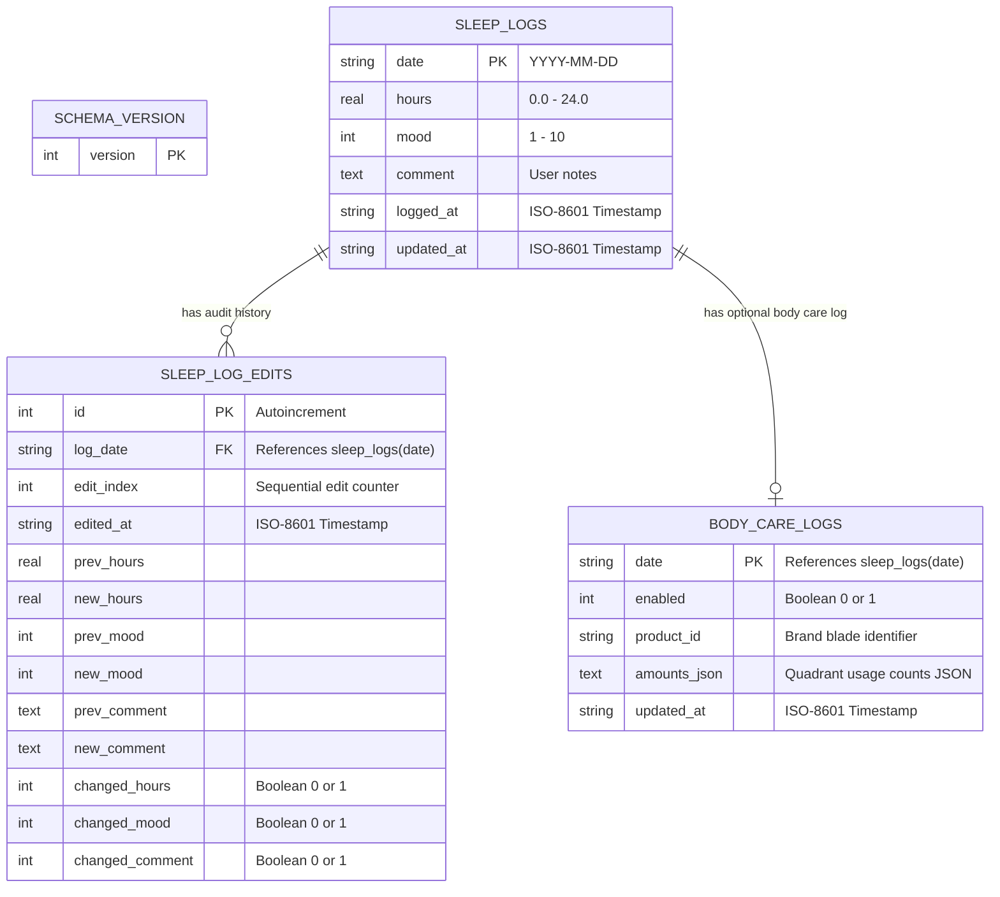
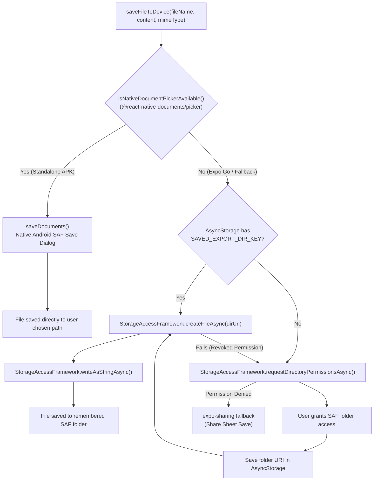

# Comprehensive Technical Documentation: `simple-sleep-journal`

This document serves as the exhaustive architectural and technical manual for `simple-sleep-journal`. It outlines the architectural philosophy, database design, Storage Access Framework (SAF) integration, theme and appearance engine, detailed component breakdowns, the build wizard CLI, and the engineering rationale behind every critical decision.

---

## 1. Executive Architecture Overview

`simple-sleep-journal` is an offline-first, privacy-focused mobile application built with React Native and Expo Router. Its primary design objective is to provide an ultra-lightweight, visually intentional mood and sleep logging tool that requires zero server infrastructure, contains zero tracking or analytics telemetry, and keeps 100% of user data securely on the local device.

### Core Architectural Pillars
- **Strict Privacy & Offline Autonomy**: All data is stored in a local SQLite database (`sleep_logs.db`). The application functions entirely without network connectivity.
- **Three-Tier Customization Architecture**:
  1. **Default Mode (Pure/Vanilla)**: Minimalist typography using the open-source Redaction font family, standard light/dark modes, with appearance studio hidden to preserve an uncluttered interface.
  2. **Baked Mode (Static Custom Build)**: Compile-time customized package with tailored branding, custom fonts, fixed color palettes, custom screen backgrounds, and compile-time disabled feature flags (e.g. self-harm tracking removed, mood stars removed, grid size locked).
  3. **Dynamic Mode (In-App Customizable)**: Full Appearance Studio unlocked directly inside the Settings screen, enabling users to load `.ttf`/`.otf` fonts from device storage, customize hex colors, set photo backgrounds per view, and toggle individual features at runtime.
- **Portable Look Engine (`.moodtheme`)**: Complete styles, feature flags, custom palettes, and base64-encoded background images can be exported to and imported from portable `.moodtheme` JSON files across devices.

### Technology Stack & Version Matrix
| Layer | Technology | Version | Purpose |
| :--- | :--- | :--- | :--- |
| Framework | React Native (New Architecture enabled) | `0.76.7` | Native runtime on Android & iOS |
| Toolchain | Expo SDK | `~52.0.33` | Native modules, splash screen, font loader |
| Navigation | Expo Router | `~4.0.17` | File-system-based tab and stack routing |
| Database | `expo-sqlite` | `~15.1.2` | Local relational SQLite storage |
| File Storage | `expo-file-system` & `@react-native-documents/picker` | `~18.0.10` / `^12.0.3` | SAF-compliant file export & import |
| Typography | Redaction Font Family & `expo-font` | `~13.0.4` | Variable degraded serif bitmap typography |
| Language | TypeScript | `~6.0.3` | Strict static typing across entire codebase |
| Testing | Node.js Test Runner (`node:test`) | Node 24 Native | Ultra-fast unit tests (~80ms execution) |

---

## 2. Directory Structure & Architectural Hierarchy

```
simple-sleep-journal/
├── android/                             # Android native Gradle project & manifests
│   ├── app/
│   │   ├── build.gradle                 # Native build settings, applicationId, signing
│   │   └── src/main/res/values/strings.xml # Native app_name string resource
├── assets/
│   ├── fonts/                           # Redaction font OTF files & custom fonts directory
│   └── images/                          # Brand razor blade images, icons, splashes
├── scripts/
│   └── build-wizard.mjs                 # Interactive CLI build configuration wizard
├── src/
│   ├── app/                             # Expo Router navigation routes
│   │   ├── (tabs)/
│   │   │   ├── _layout.tsx              # Paged dual-screen container (Calendar + Settings)
│   │   │   ├── index.tsx                # Calendar grid tab entry
│   │   │   └── settings.tsx             # Settings tab entry
│   │   └── _layout.tsx                  # Root layout, theme provider, font preloading
│   ├── components/                      # Modular UI components
│   │   ├── calendar-grid/               # Paged calendar grid, year/month headers, day cells
│   │   ├── confirm-dialog/              # Modal confirmation dialogs
│   │   ├── nav-bar/                     # Bottom animated navigation bar
│   │   ├── settings/                    # Settings view, Appearance Studio, export/import
│   │   ├── sleep-modal/                 # Daily logging modal, hours wheel, stars, body care
│   │   └── wheel-picker/                # Virtualized cyclical wheel picker
│   ├── constants/                       # Theme defaults, build configs, grid constants
│   ├── contexts/                        # React Context providers (Appearance, Settings, Nav)
│   ├── hooks/                           # Custom utility hooks (Color scheme resolution)
│   ├── lib/                             # Core library utilities (Database, SAF File Saver, Theme)
│   └── types/                           # TypeScript interfaces and type definitions
└── tests/                               # Native unit test suites
```

---

## 3. Database Architecture & Migration Engine (`src/lib/db.ts`)

Data persistence is handled by `expo-sqlite`, providing SQLite ACID transactions directly on the user's filesystem.

### 3.1 Relational Schema



### 3.2 Table Definitions
1. **`sleep_logs`**: Primary log table storing hours slept, mood rating (scaled 1-10), daily notes, and audit timestamps. The primary key is the ISO date (`YYYY-MM-DD`).
2. **`sleep_log_edits`**: Full chronological audit trail. Whenever a user edits an existing log entry, a row is inserted documenting exactly which fields changed, the previous values, and the new values. This allows users to review their complete history in the Day Modal.
3. **`body_care_logs`**: Optional tracking quadrant for self-harm / razor blade usage. Records the product brand ID (e.g. `astra-superior-platinum`, `gillette-platinum`, `isana-men-classic`) and a serialized JSON map of uses per quadrant (`top-left`, `top-right`, `bottom-left`, `bottom-right`).
4. **`schema_version`**: Idempotent migration tracker that stores the current database version.

### 3.3 Transactional Safety & Migration Pipeline
On application startup, `initDatabase()` opens or creates `sleep_logs.db` and checks `schema_version`. Migrations are executed within atomic transactions:
- **Migration 1**: Creation of `sleep_logs` table with indexed `date`.
- **Migration 2**: Creation of `sleep_log_edits` table with foreign key index on `log_date`.
- **Migration 3**: Creation of `body_care_logs` table.

---

## 4. Android Storage Access Framework (SAF) & File Export Engine (`src/lib/file-saver.ts`)

File export on modern Android (API 29+ / Android 10, 11, 12, 13, 14, 15) is strictly governed by Scoped Storage and the Storage Access Framework (SAF).

### 4.1 The Transient Intent URI Challenge
In standard React Native development, using system intents (`ACTION_CREATE_DOCUMENT`) returns a `content://` URI with transient write permissions. If an application attempts to write to this URI via low-level standard filesystem APIs without keeping write channels open, Android's `SecurityException` or `File.create does not work with SAF content:// uris` error is thrown.

### 4.2 The Four-Tier Fallback Cascade
To provide 100% reliable file exports across standalone builds, custom APKs, and Expo Go, `saveFileToDevice()` implements a 4-tier fallback cascade:



### 4.3 Export Formats
- **JSON Backup (`.json`)**: Full database dump containing `logs`, `edits`, and `bodyCareLogs`. Can be imported back into any instance of the app.
- **Spreadsheet (`.csv`)**: RFC 4180 compliant CSV export with proper quotation escaping for dates, hours, mood, comments, edit history, and body care amounts.
- **Text Summary (`.txt`)**: Human-readable narrative report formatted with log timestamps and chronological edit history.
- **Theme Look (`.moodtheme`)**: Standalone JSON theme specification with embedded base64 background graphics.

---

## 5. Theme & Appearance Engine

The appearance system is powered by `AppearanceProvider` (`src/contexts/appearance-context.tsx`) and pure serialization helpers (`src/lib/theme-utils.ts`).

### 5.1 The `.moodtheme` Specification
The `.moodtheme` file is a portable JSON structure that encodes complete visual styling:
```json
{
  "format": "simple-sleep-journal-theme",
  "version": 1,
  "createdAt": "2026-10-21T18:30:00.000Z",
  "name": "Cat Cyberpunk",
  "palette": {
    "dark": {
      "background": "#090A0F",
      "text": "#00FFCC",
      "backgroundElement": "#141724",
      "backgroundSelected": "#1F2538",
      "textSecondary": "#5D707F"
    }
  },
  "font": {
    "name": "CustomPixel",
    "dataUriOrPath": null
  },
  "backgrounds": {
    "calendarBase64": "data:image/png;base64,iVBORw0KGgo...",
    "settingsBase64": "data:image/png;base64,iVBORw0KGgo..."
  },
  "features": {
    "bodyCareEnabled": false,
    "moodStarsEnabled": true,
    "commentsEnabled": true,
    "gridPickerEnabled": true
  }
}
```

### 5.2 Build Mode Matrix & Rules
The system enforces strict behavioral rules based on `buildConfig.mode`:

| Rule / Feature | `default` Mode | `baked` Mode | `dynamic` Mode |
| :--- | :--- | :--- | :--- |
| **Primary Typography** | Redaction (Bitmap Serif) | Baked Font or Redaction | User Selected Font |
| **Appearance Studio in Settings** | Hidden | Hidden | Fully Visible & Interactive |
| **Theme Export (`.moodtheme`)** | **Disabled** (Hidden) | **Enabled** (Can export look) | **Enabled** (Can export look) |
| **Theme Import (`.moodtheme`)** | **Enabled** | **Enabled** | **Enabled** |
| **Reset Appearance Behavior** | Restores pure vanilla defaults | Restores **baked** defaults | Restores dynamic defaults |
| **Target Audience** | Purists who want minimal look | Branded / Personalized distribution | Power users who like theme tweaking |

### 5.3 Dynamic Font Loading
When a user selects a custom `.ttf` or `.otf` file in the Appearance Studio, it is loaded dynamically into the React Native font registry using `Font.loadAsync({ [fontName]: uri })`. The `resolveFont(variant)` utility automatically maps font weight slots (`display`, `title`, `bold`, `regular`, `italic`) to the custom loaded font family or falls back to the corresponding Redaction weight.

### 5.4 Readability Scrim Mathematics
When custom background images are set for the Calendar or Settings screens, the content is rendered over an `ImageBackground` with an absolute fill scrim:
```tsx
<View
  style={[
    StyleSheet.absoluteFill,
    { backgroundColor: colors.background, opacity: 0.65 },
  ]}
/>
```
This 65% opacity overlay blends the user's custom photo with the active theme background, ensuring contrast ratios remain compliant with WCAG accessibility guidelines while preserving full visual texture.

---

## 6. Component Architecture & Deep Dive

### 6.1 `CalendarGrid` (`src/components/calendar-grid/`)
- **File Structure**:
  - `calendar-grid.tsx`: Main interactive view, month/year headers, infinite pager bindings.
  - `calendar-grid.styles.ts`: Scaled layout rules and typography bounds.
  - `calendar-grid.utils.ts`: Pure functional helpers for calendar cell calculation, font selection, and row height clamping.
- **Infinite Pagination Engine**: Uses `react-native-pager-view` with a virtual radius around a center page (`CENTER_PAGE = 600`). Scrolling months computes delta offsets from the current date via `pageToYearMonth()`.
- **Dynamic Cell Height Clamping**: `getGridRowHeight(screenHeight, rows)` clamps row heights between `MIN_ROW_HEIGHT` (46px) and `MAX_ROW_HEIGHT` (90px) to prevent layout overflow on foldable or tablet displays (such as Galaxy Z Fold).
- **Day Cell States**: Every day cell is dynamically typed into one of five states: `today`, `logged`, `future`, `unlogged`, or `otherMonth`, each receiving distinct color tokens from `colors`.

### 6.2 `SleepModal` (`src/components/sleep-modal/`)
- **File Structure**:
  - `sleep-modal.tsx`: Interactive bottom-sheet modal.
  - `sleep-modal.styles.ts`: Modal overlays, hours column, star spacing, quadrant button geometry.
- **Gestural Dismissal**: Built with `PanResponder` to track downward drag velocity. Dismisses smoothly if downward drag exceeds 90px.
- **Hours Cyclical Wheel Picker**: Infinite scrolling vertical wheel picker cycling seamlessly from 0h to 24h.
- **10-Star Mood Rating**: Interactive touch-and-drag scrubbing. Moving a finger across the star row computes localized X-offsets and updates the rating in real-time.
- **Razor Blade Tracker (Body Care)**:
  - 4 distinct clickable quadrants (`top-left`, `top-right`, `bottom-left`, `bottom-right`).
  - High-resolution SVG-rendered brand overlays for Astra, Gillette, and Isana blades.
  - Numeric usage counters per quadrant.
- **Feature Flag Responsiveness**: When `features.bodyCareEnabled`, `features.moodStarsEnabled`, or `features.commentsEnabled` are toggled off, their respective DOM sections are completely unmounted, and database saving omits those fields.

### 6.3 `Settings` (`src/components/settings/`)
- **File Structure**:
  - `settings.tsx`: Complete settings panel, appearance controls, and data management.
  - `settings.styles.ts`: Switch tracks, dialogs, studio cards, and responsive input styles.
- **Grid Configuration**: Displays rows × columns wheel pickers when `gridPickerEnabled` is true, or a sleek locked badge when grid size is locked.
- **Appearance Studio**: When `inAppCustomizationEnabled` is active, displays controls for picking fonts, importing/clearing background images, choosing color palettes, and toggling feature flags.
- **Data & Look Management**: Unified actions for exporting logs (JSON/CSV/TXT), importing backups, importing looks (`.moodtheme`), exporting looks (`.moodtheme`), and resetting appearance.

### 6.4 `NavBar` (`src/components/nav-bar/`)
- **File Structure**:
  - `nav-bar.tsx`: Bottom navigation bar with spring-animated icons.
  - `nav-bar.styles.ts`: Positioning, clearance constants, and glassmorphic container styling.
- **Spring Animations**: Animated springs smoothly enlarge the active tab icon (1.18x scale) with stiffness 340 and damping 18.
- **Horizontal Swipe Detection**: Embedded `PanResponder` allows horizontal swiping anywhere on the navigation bar to transition between the Calendar and Settings tabs.

### 6.5 `WheelPicker` (`src/components/wheel-picker/`)
- **File Structure**:
  - `wheel-picker.tsx`: Generic cyclical vertical wheel picker.
- **Cyclical Paging Mechanism**: Built on top of `react-native-pager-view` with centered initial pages.
- **Imperative Handle**: Exposes `bump(delta)` and `syncTo(page)` via `useImperativeHandle` for external synchronization without triggering recursive render cycles.
- **Multi-Picker Synchronization Lock**: Features a shared `lockRef` mechanism that prevents simultaneous touch-stealing when multiple wheel pickers (e.g. rows and columns) are adjacent.

### 6.6 `ConfirmDialog` (`src/components/confirm-dialog/`)
- **File Structure**:
  - `confirm-dialog.tsx`: Reusable modal confirmation dialog.
  - `confirm-dialog.styles.ts`: Modal backdrop, dialog card, and affirmative/negative buttons.
- **Themed Modals**: Uses dynamic `colors.modalBackground` and `colors.modalOverlay` with accessible typography.

---

## 7. Interactive Build Wizard CLI (`scripts/build-wizard.mjs`)

The Build Wizard allows creators and developers to generate custom APK and iOS builds with custom branding, identifiers, and features.

### 7.1 Running the Wizard
```bash
# Interactive Mode
node scripts/build-wizard.mjs
# or via npm script
npm run wizard

# Headless / Automated CLI Flag Mode
node scripts/build-wizard.mjs \
  --mode=baked \
  --name="mood journal (baked)" \
  --packageId="com.shittyassapps.sleepinapp.baked" \
  --theme=cyberpunk \
  --bodyCare=false \
  --calendarBg="assets/images/custom-cat-bg.png"
```

### 7.2 Files Modified by the Wizard
1. **`src/constants/build-config.json`**: Compiles the mode, feature flags, and baked theme into the JavaScript bundle.
2. **`app.json`**: Updates `expo.name`, `expo.scheme`, and `expo.android.package`.
3. **`android/app/build.gradle`**: Updates `defaultConfig.applicationId` to ensure the APK installs side-by-side with other packages.
4. **`android/app/src/main/res/values/strings.xml`**: Updates the native Android OS launcher label (`app_name`).

---

## 8. Engineering Rationale ("Why It Works This Way")

### 8.1 Why SQLite over Plain AsyncStorage for Logs
While `AsyncStorage` is sufficient for simple preferences, logs require transactional integrity, structured indexing, audit history, and fast range queries across thousands of dates. SQLite guarantees ACID transactions, eliminating data corruption risks during sudden OS task killing.

### 8.2 Why the Redaction Font Family
The Redaction font was created by Titus Kaphar and Reginald Dwayne Betts for The Just Imperative. It features variable degradation grades (Redaction 20, 35, 50, 70) with bitmap serif aesthetics. Its distinctive brutalist look gives `simple-sleep-journal` its signature intentional appearance.

### 8.3 Why Baked Mode Resets to Baked Defaults
If a user installs a branded or personalized APK (e.g. `mood journal (baked)` with custom colors and razor blades disabled for personal well-being), clicking "Reset Appearance" should never revert to vanilla defaults; doing so would break the creator's intended experience. Instead, baked builds reset to their own baked compile-time defaults.

### 8.4 Why `.moodtheme` Embeds Images as Base64
Referencing local filesystem paths (e.g. `/sdcard/Download/photo.jpg`) makes theme files non-portable. If a user shares a theme file or restores it on a new phone, local file paths break. Embedding background graphics as base64 data URIs ensures the theme file is 100% self-contained and renders identically anywhere.

---

## 9. Testing, Verification & Build Guide

### 9.1 Unit Testing
Tests use Node.js native test runner with zero external test runner overhead:
```bash
npm test
```
- Tests all pure utilities in `tests/`: body care calculations, grid row height clamping, date calendar generators, CSV escaping, theme validation, and reset behavior.
- Runs in ~80ms.

### 9.2 TypeScript Type Checking
```bash
npm run typecheck
```
Ensures 0 type errors across all application and script files.

### 9.3 Local Android Gradle Compilation
```bash
export JAVA_HOME=/usr/lib/jvm/java-21-openjdk-amd64
export ANDROID_HOME=$HOME/Android/Sdk

# Compile Debug APK
cd android && ./gradlew assembleDebug

# Compile Standalone Release APK
cd android && ./gradlew assembleRelease -x lint
```
The compiled APK will be output to:
- Debug: `android/app/build/outputs/apk/debug/app-debug.apk`
- Release: `android/app/build/outputs/apk/release/app-release.apk`
