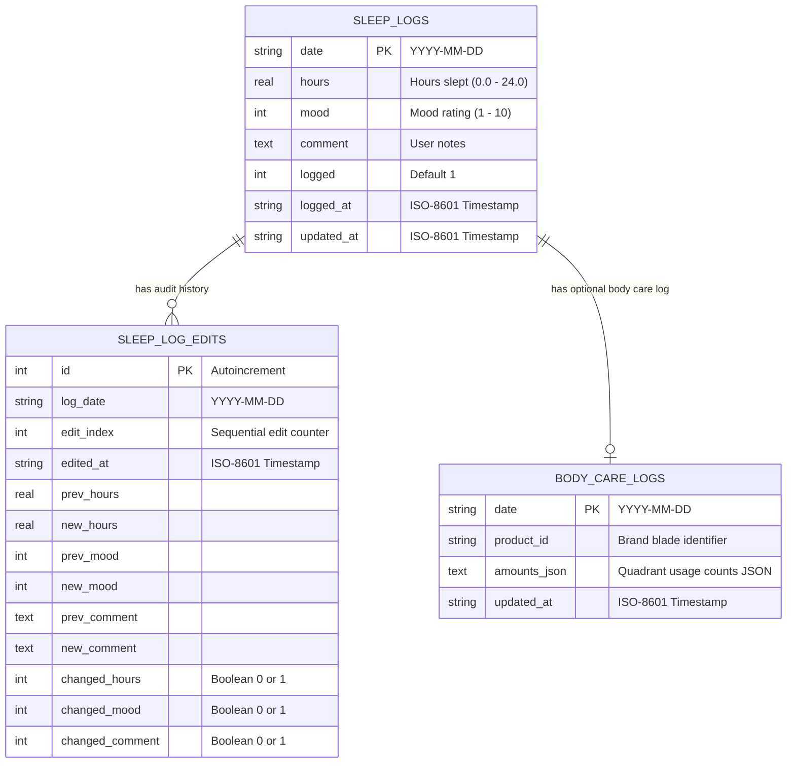
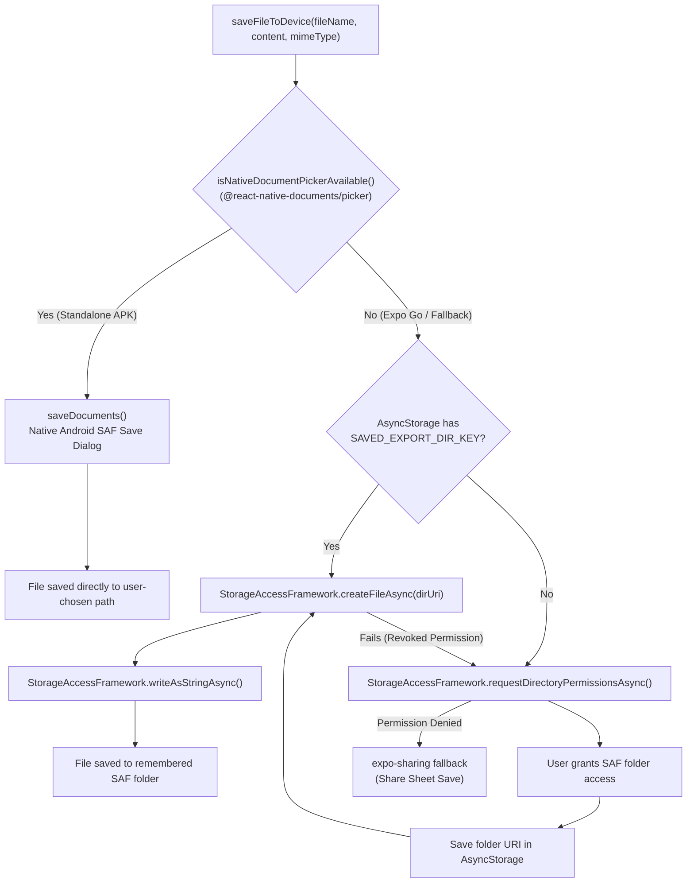

# Comprehensive Technical Documentation: `simple-sleep-journal`

This document serves as the exhaustive architectural and technical manual for `simple-sleep-journal`. It outlines the architectural philosophy, database design, Storage Access Framework (SAF) integration, theme and appearance engine, detailed component breakdowns, the build wizard CLI, and the engineering rationale behind every critical decision.

---

## 1. Executive Architecture Overview

`simple-sleep-journal` is an offline-first, privacy-focused mobile application built with React Native and Expo Router. Its primary design objective is to provide an ultra-lightweight, visually intentional mood and sleep logging tool that requires zero server infrastructure, contains zero tracking or analytics telemetry, and keeps 100% of user data securely on the local device.

### Core Architectural Pillars
- **Strict Privacy & Offline Autonomy**: All data is stored in a local SQLite database (`sleepinapp.db`). The application functions entirely without network connectivity.
- **Three-Tier Customization Architecture**:
  1. **Default Mode (Pure/Vanilla)**: Minimalist typography using the open-source Redaction font family, standard light/dark modes, with appearance studio hidden to preserve an uncluttered interface.
  2. **Baked Mode (Static Custom Build)**: Compile-time customized package with tailored branding, custom fonts, fixed color palettes, custom screen backgrounds, and compile-time disabled feature flags (e.g. self-harm tracking removed, mood stars removed, grid size locked).
  3. **Dynamic Mode (In-App Customizable)**: Full Appearance Studio unlocked directly inside the Settings screen, enabling users to load `.ttf`/`.otf` fonts from device storage, customize hex colors, set photo backgrounds per view, and toggle individual features at runtime.
- **Portable Look Engine (`.moodtheme`)**: Complete styles, feature flags, custom palettes, and base64-encoded background images can be exported to and imported from portable `.moodtheme` JSON files across devices.

### Technology Stack & Version Matrix
| Layer | Technology | Version | Purpose |
| :--- | :--- | :--- | :--- |
| Framework | React Native (New Architecture enabled) | `0.88.1` | Native runtime on Android & iOS |
| UI Runtime | React | `19.3.0` | Component rendering & React Compiler (`reactCompiler: true`) |
| Toolchain | Expo SDK | `^58.0.26` | Native modules, splash screen, font loader |
| Navigation | Expo Router | `~58.0.32` | File-system-based tab and stack routing |
| Paging | `react-native-pager-view` | `9.0.7` | Native horizontal/vertical paging (`ComposePagerView` on Android) |
| Database | `expo-sqlite` | `~58.0.18` | Local relational SQLite storage |
| File Storage | `expo-file-system` & `@react-native-documents/picker` | `~58.0.14` / `^12.0.3` | SAF-compliant file export & import |
| Typography | Redaction Font Family & `expo-font` | `~58.0.12` | Variable degraded serif bitmap typography |
| Language | TypeScript | `~6.0.3` | Strict static typing across entire codebase |
| Testing | Node.js Test Runner (`node:test`) | Node 24 Native | Ultra-fast unit tests (~90ms execution) |

---

## 2. Directory Structure & Architectural Hierarchy

```
simple-sleep-journal/
├── android/                             # Android native Gradle project & manifests
│   ├── app/
│   │   ├── build.gradle                 # Native build settings, applicationId, signing
│   │   └── src/main/res/values/strings.xml # Native app_name string resource
├── assets/
│   ├── fonts/                           # Redaction font OTF files & custom fonts directory
│   └── images/                          # Brand razor blade images, icons, splashes
├── scripts/
│   └── build-wizard.mjs                 # Interactive CLI build configuration wizard
├── src/
│   ├── app/                             # Expo Router navigation routes
│   │   ├── (tabs)/
│   │   │   ├── _layout.tsx              # Paged dual-screen container (Calendar + Settings)
│   │   │   ├── index.tsx                # Calendar grid tab entry
│   │   │   └── settings.tsx             # Settings tab entry
│   │   └── _layout.tsx                  # Root layout, theme provider, font preloading
│   ├── components/                      # Modular UI components
│   │   ├── calendar-grid/               # Paged calendar grid, year/month headers, day cells
│   │   ├── confirm-dialog/              # Modal confirmation dialogs
│   │   ├── nav-bar/                     # Bottom animated navigation bar
│   │   ├── settings/                    # Settings view, Appearance Studio, export/import
│   │   ├── sleep-modal/                 # Daily logging modal, hours wheel, stars, body care
│   │   └── wheel-picker/                # Virtualized cyclical wheel picker
│   ├── constants/                       # Theme defaults, build configs, grid constants
│   ├── contexts/                        # React Context providers (Appearance, Settings, Nav)
│   ├── hooks/                           # Custom utility hooks (Color scheme resolution)
│   ├── lib/                             # Core library utilities (Database, SAF File Saver, Theme)
│   └── types/                           # TypeScript interfaces and type definitions
└── tests/                               # Native unit test suites
```

---

## 3. Database Architecture & Serialization Engine (`src/lib/db.ts`)

Data persistence is handled by `expo-sqlite`, providing SQLite storage directly on the user's filesystem (`sleepinapp.db`).

### 3.1 Relational Schema



### 3.2 Table Definitions
1. **`sleep_logs`**: Primary log table storing hours slept, mood rating (scaled 1-10), daily notes, `logged` flag, and audit timestamps (`logged_at`, `updated_at`). The primary key is the ISO date (`YYYY-MM-DD`).
2. **`sleep_log_edits`**: Full chronological audit trail. Whenever a user edits an existing log entry, a row is inserted documenting exactly which fields changed, the previous values, and the new values, indexed on `log_date` with a unique `(log_date, edit_index)` index.
3. **`body_care_logs`**: Optional tracking quadrant for self-harm / razor blade usage. Records the product brand ID (e.g. `astra-superior-platinum`, `gillette-platinum`, `isana-men-classic`), a serialized JSON map of uses per quadrant (`top-left`, `top-right`, `bottom-left`, `bottom-right`), and `updated_at`.

### 3.3 Operation Queue & Handle Recovery
On application startup, `initDB()` opens `sleepinapp.db`, creates missing tables and indexes idempotently (`CREATE TABLE IF NOT EXISTS`, `CREATE INDEX IF NOT EXISTS`, `CREATE UNIQUE INDEX IF NOT EXISTS`), and checks `PRAGMA table_info(sleep_logs)` to add `logged_at` if missing.

All database operations pass through `withDb()` / `enqueue()`, a FIFO promise queue (`opQueue`) that serializes native SQLite access. If Android releases the underlying `NativeDatabase` handle, `withDbInner()` resets the cached instance and transparently reopens a fresh database handle before retrying the operation. `getAllLoggedDates()` enables `CalendarGrid` to preload every logged date string into memory in a single query on startup.

---

## 4. Android Storage Access Framework (SAF) & File Export Engine (`src/lib/file-saver.ts`)

File export on modern Android (API 29+ / Android 10+) is strictly governed by Scoped Storage and the Storage Access Framework (SAF).

### 4.1 The Transient Intent URI Challenge
In standard React Native development, using system intents (`ACTION_CREATE_DOCUMENT`) returns a `content://` URI with transient write permissions. If an application attempts to write to this URI via low-level standard filesystem APIs without keeping write channels open, Android's `SecurityException` or `File.create does not work with SAF content:// uris` error is thrown.

### 4.2 The Four-Tier Fallback Cascade
To provide reliable file exports across standalone builds, custom APKs, and Expo Go, `saveFileToDevice()` implements a 4-tier fallback cascade:



### 4.3 Export Formats
- **JSON Backup (`.json`)**: Full database dump containing `logs`, `edits`, and `bodyCareLogs`. Can be imported back into any instance of the app.
- **Spreadsheet (`.csv`)**: RFC 4180 compliant CSV export with proper quotation escaping for dates, hours, mood, comments, edit history, and body care amounts.
- **Text Summary (`.txt`)**: Human-readable narrative report formatted with log timestamps and chronological edit history.
- **Theme Look (`.moodtheme`)**: Standalone JSON theme specification with embedded base64 background graphics.

---

## 5. Theme & Appearance Engine

The appearance system is powered by `AppearanceProvider` (`src/contexts/appearance-context.tsx`) and pure serialization helpers (`src/lib/theme-utils.ts`).

### 5.1 The `.moodtheme` Specification
The `.moodtheme` file is a portable JSON structure that encodes complete visual styling:
```json
{
  "format": "simple-sleep-journal-theme",
  "version": 1,
  "createdAt": "2026-10-21T18:30:00.000Z",
  "name": "Cat Cyberpunk",
  "palette": {
    "dark": {
      "background": "#090A0F",
      "text": "#00FFCC",
      "backgroundElement": "#141724",
      "backgroundSelected": "#1F2538",
      "textSecondary": "#5D707F"
    }
  },
  "font": {
    "name": "CustomPixel",
    "dataUriOrPath": null
  },
  "backgrounds": {
    "calendarBase64": "data:image/png;base64,iVBORw0KGgo...",
    "settingsBase64": "data:image/png;base64,iVBORw0KGgo..."
  },
  "features": {
    "bodyCareEnabled": false,
    "moodStarsEnabled": true,
    "commentsEnabled": true,
    "gridPickerEnabled": true
  }
}
```

### 5.2 Build Mode Matrix & Rules
The system enforces strict behavioral rules based on `buildConfig.mode`:

| Rule / Feature | `default` Mode | `baked` Mode | `dynamic` Mode |
| :--- | :--- | :--- | :--- |
| **Primary Typography** | Redaction (Bitmap Serif) | Baked Font or Redaction | User Selected Font |
| **Appearance Studio in Settings** | Hidden | Hidden | Fully Visible & Interactive |
| **Theme Export (`.moodtheme`)** | **Disabled** (Hidden) | **Enabled** (Can export look) | **Enabled** (Can export look) |
| **Theme Import (`.moodtheme`)** | **Enabled** | **Enabled** | **Enabled** |
| **Reset Appearance Behavior** | Restores pure vanilla defaults | Restores **baked** defaults | Restores dynamic defaults |
| **Target Audience** | Purists who want minimal look | Branded / Personalized distribution | Power users who like theme tweaking |

### 5.3 Dynamic Font Loading
When a user selects a custom `.ttf` or `.otf` file in the Appearance Studio, it is loaded dynamically into the React Native font registry using `Font.loadAsync({ [fontName]: uri })`. The `resolveFont(variant)` utility automatically maps font weight slots (`display`, `title`, `bold`, `regular`, `italic`) to the custom loaded font family or falls back to the corresponding Redaction weight.

### 5.4 Wallpaper Layering
When custom background images are set for the Calendar or Settings screens, `src/app/(tabs)/_layout.tsx` renders an `expo-image` `<Image>` directly behind each screen container:
```tsx
<View style={{ width, height: "100%", backgroundColor: colors.background }}>
  {backgrounds.calendar && (
    <Image
      source={{ uri: backgrounds.calendar }}
      style={StyleSheet.absoluteFill}
      contentFit="cover"
      cachePolicy="memory-disk"
    />
  )}
  <CalendarGrid />
</View>
```
To ensure wallpaper visibility, `CalendarGrid` and `Settings` root containers apply `{ backgroundColor: backgrounds[screen] ? "transparent" : colors.background }`.

### 5.5 Font Credits Suppression Rule
The Settings screen maintains full author attribution and typography credits for the original Redaction typeface. When a custom font is active (or in baked builds using Comic Sans), the font credits section automatically hides to reflect the active font family. Once appearance is reset back to Redaction, the complete original credits block reappears.

---

## 6. Component Architecture & Deep Dive

### 6.1 `CalendarGrid` (`src/components/calendar-grid/`)
- **File Structure**:
  - `calendar-grid.tsx`: Main interactive view, synchronized year/month/day pagers, preloaded month cache, and width/spring animations.
  - `calendar-grid.styles.ts`: Scaled layout rules, header typography, and off-screen measurement overlay styles.
  - `calendar-grid.utils.ts`: Pure helpers for calendar cell generation, month grouping (`groupDatesByMonth`), header width scaling (`computeWidthScale`), early swipe triggering (`getSwipeTargetPage`), and settlement guards (`evaluatePageSelected`, `isScrollSettled`, `resolveCanceledSwipePage`).
- **Preloaded Infinite Pagination**: Uses `react-native-pager-view` centered at `CENTER_PAGE = 60` (`TOTAL_PAGES = 121`, `MONTH_RENDER_RADIUS = 2`, `GRID_RENDER_RADIUS = 2` with matching `offscreenPageLimit = 2`). On startup, `getAllLoggedDates()` preloads every logged date into a `Map<string, Set<string>>` so neighboring months render immediately with logged indicators and memoized `YearPage`/`MonthPage`/`GridPage` subcomponents.
- **Swipe-Start Transition Timing (`react-native-pager-view@9.0.7`)**: Because Android `ComposePagerView` emits `onPageSelected` from `settledPage` (after the scroll animation ends) and may emit `"idle"` early on `DragInteraction.Stop`, `handlePageScroll` triggers `syncAllPagers` past `SWIPE_TRIGGER_THRESHOLD = 0.06` (`setPageWithoutAnimation` on synced headers + `gridScaleAnim` `0.98 -> 1` spring + `260ms` `Easing.out(Easing.cubic)` header width timing), while `expectedPageRef`, `evaluatePageSelected`, and `isScrollSettled` prevent stale events or premature `"idle"` flickers.
- **Pre-Measured Header Scaling**: All 12 month names and the year range (`YEAR_TOTAL_PAGES = 11`) are pre-measured per active font in an off-screen `measureOverlay` with single-line enforcement (`numberOfLines={1}`) and proportional `computeWidthScale` shrinking if a wide custom font exceeds `MONTH_FIXED_WIDTH` (`320px`) or `YEAR_FIXED_WIDTH` (`300px`).
- **Dynamic Cell Height Clamping**: `getGridRowHeight(screenHeight, rows)` clamps row heights between `MIN_ROW_HEIGHT` (46px) and `MAX_ROW_HEIGHT` (90px) to prevent layout overflow on foldable or tablet displays.
- **Day Cell States**: Every day cell is dynamically typed into one of five states: `today`, `logged`, `future`, `unlogged`, or `otherMonth`, each receiving distinct color tokens from `colors`.

### 6.2 `SleepModal` (`src/components/sleep-modal/`)
- **File Structure**:
  - `sleep-modal.tsx`: Interactive bottom-sheet modal.
  - `sleep-modal.styles.ts`: Modal overlays, hours column, star spacing, quadrant button geometry.
- **Gestural Dismissal**: Built with `PanResponder` to track downward drag velocity. Dismisses smoothly if downward drag exceeds 90px.
- **Hours Cyclical Wheel Picker**: Infinite scrolling vertical wheel picker cycling seamlessly from 0h to 24h.
- **10-Star Mood Rating**: Interactive touch-and-drag scrubbing. Moving a finger across the star row computes localized X-offsets and updates the rating in real-time.
- **Razor Blade Tracker (Body Care)**:
  - 4 distinct clickable quadrants (`top-left`, `top-right`, `bottom-left`, `bottom-right`).
  - Brand blade overlays for Astra, Gillette, and Isana blades.
  - Numeric usage counters per quadrant.
- **Feature Flag Responsiveness**: When `features.bodyCareEnabled`, `features.moodStarsEnabled`, or `features.commentsEnabled` are toggled off, their respective UI sections are unmounted, and database saving omits those fields.

### 6.3 `Settings` (`src/components/settings/`)
- **File Structure**:
  - `settings.tsx`: Complete settings panel, Appearance Studio modal, and unified data management.
  - `settings.styles.ts`: Switch tracks, dialogs, studio modal containers, hex color inputs, and responsive input styles.
- **Header & Studio Launcher**:
  - Displays the `settings` title with an access wand icon in the top-right corner.
  - In `dynamic` mode: clicking the magic wand icon (`color-wand-outline`) opens the full **Appearance Studio Modal**.
  - In `default` mode: clicking the top-right reset icon (`sparkles-outline`) displays a confirmation prompt: *"Reset all appearance settings back to vanilla defaults?"* and restores vanilla styling without opening Appearance Studio.
- **Grid Configuration**:
  - Displays rows × columns wheel pickers when `gridPickerEnabled` is true.
  - When `gridPickerEnabled` is false, the grid rows and columns pickers disappear from the screen, maintaining the configured grid size cleanly.
- **Color Scheme Toggle**:
  - Controlled by the `colorSchemeToggleEnabled` feature flag.
  - When enabled, renders the 3-state switch track using `sunny-outline` (light), `contrast-outline` (automatic), and `moon-outline` (dark), with spring indicator interpolation.
  - When disabled, the entire switch track is omitted, locking the app to the selected scheme.
- **Typography & Font Credits**:
  - Preserves the full attribution block for typeface design (Jeremy Mickel), creative direction (Forest Young), The Redaction authors (Titus Kaphar, Reginald Dwayne Betts), and application author (kvvzie).
- **Appearance Studio Modal Overlay**:
  - **Typography**: Displays the active font (Redaction, Comic Sans, or custom font), offers a `.ttf`/`.otf` picker, and a reset button.
  - **Wallpapers**: Powered by `expo-image` with native Glide hardware decoding, supporting large photos, WebP, PNG, JPEG, and Samsung HEIC/HEIF camera captures for Calendar and Settings backgrounds.
  - **Color Customization**: Direct hex color inputs and live preview swatches for background, text, card elements, selected highlights, and secondary text, accompanied by quick palette swatches.
  - **Feature Toggles**: Runtime switches for color scheme switcher, razor blade tracker, mood stars, daily comments, and flexible grid picker.
  - **Reset Button**: Embedded at the bottom of the studio to restore mode-appropriate defaults.
- **Data & Look Management**:
  - Primary action buttons: `export` and `import`.
  - `export` opens format selection: JSON Backup, CSV Spreadsheet, TXT Summary, and (if allowed) App Look (`.moodtheme`).
  - `import` opens choice dialog: Data Backup (JSON) or App Look (`.moodtheme`).

### 6.4 `NavBar` (`src/components/nav-bar/`)
- **File Structure**:
  - `nav-bar.tsx`: Bottom navigation bar with spring-animated icons.
  - `nav-bar.styles.ts`: Positioning, clearance constants, and translucent container styling.
- **Spring Animations**: Animated springs smoothly enlarge the active tab icon (1.18x scale) with stiffness 340 and damping 18.
- **Horizontal Swipe Detection**: Embedded `PanResponder` allows horizontal swiping anywhere on the navigation bar to transition between the Calendar and Settings tabs.

### 6.5 `WheelPicker` (`src/components/wheel-picker/`)
- **File Structure**:
  - `wheel-picker.tsx`: Generic cyclical vertical wheel picker.
- **Cyclical Paging Mechanism**: Built on top of `react-native-pager-view` with centered initial pages.
- **Imperative Handle**: Exposes `bump(delta)` and `syncTo(page)` via `useImperativeHandle` for external synchronization without triggering recursive render cycles.
- **Multi-Picker Synchronization Lock**: Features a shared `lockRef` mechanism that prevents simultaneous touch-stealing when multiple wheel pickers (e.g. rows and columns) are adjacent.

### 6.6 `GoogleColorPicker` (`src/components/color-picker/`)
- **File Structure**:
  - `google-color-picker.tsx`: Interactive color picker component modeled after Google's hex color picker.
- **Color Mathematics & Color Space**:
  - Full bidirectional conversion between RGB, Hex, and HSV color spaces (`hsvToRgb`, `rgbToHsv`, `hexToRgb`, `rgbToHex`).
  - Interactive 2D Saturation / Value plane: Layered with a horizontal white-to-transparent gradient and vertical transparent-to-black gradient over the pure hue background color.
  - Interactive 1D Hue spectrum slider: 360° continuous rainbow strip with draggable thumb.
  - Direct Hex input field with two-way reactive state binding and instant validation.
  - Quick palette chips for rapid selection of popular theme swatches.

### 6.7 `ConfirmDialog` (`src/components/confirm-dialog/`)
- **File Structure**:
  - `confirm-dialog.tsx`: Reusable modal confirmation dialog.
  - `confirm-dialog.styles.ts`: Modal backdrop, dialog card, and affirmative/negative buttons.
- **Themed Modals**: Uses dynamic `colors.modalBackground` and `colors.modalOverlay` with accessible typography.

---

## 7. Interactive Build Wizard CLI (`scripts/build-wizard.mjs`)

The Build Wizard allows creators and developers to generate custom APK and iOS builds with custom branding, identifiers, and features.

### 7.1 Running the Wizard
```bash
# Interactive Mode
node scripts/build-wizard.mjs
# or via npm script
npm run wizard

# Headless / Automated CLI Flag Mode with Custom Hex Colors
node scripts/build-wizard.mjs \
  --mode=baked \
  --name="mood journal (baked)" \
  --packageId="com.shittyassapps.sleepinapp.baked" \
  --bodyCare=false \
  --bg="#1E0538" \
  --text="#FFE600" \
  --element="#6B1D99" \
  --selected="#00FF99" \
  --textSecondary="#FF70C5" \
  --calendarBg="assets/images/custom-cat-bg.png"
```

### 7.2 Custom Hex Color Input
The build wizard provides direct custom hex color entry as Option 1 in interactive mode:
- Background hex (e.g. `#1E0538`)
- Text hex (e.g. `#FFE600`)
- Card / element background hex (e.g. `#6B1D99`)
- Selected accent hex (e.g. `#00FF99`)
- Secondary / muted text hex (e.g. `#FF70C5`)
It also accepts CLI parameters `--bg`, `--text`, `--element`, `--selected`, `--textSecondary` for automated builds.

### 7.3 Files Modified by the Wizard
1. **`src/constants/build-config.json`**: Compiles the mode, feature flags, and baked theme into the JavaScript bundle.
2. **`app.json`**: Updates `expo.name`, `expo.scheme`, and `expo.android.package`.
3. **`android/app/build.gradle`**: Updates `defaultConfig.applicationId` to ensure the APK installs side-by-side with other packages.
4. **`android/app/src/main/res/values/strings.xml`**: Updates the native Android OS launcher label (`app_name`).

---

## 8. Engineering Rationale ("Why It Works This Way")

### 8.1 Why SQLite over Plain AsyncStorage for Logs
While `AsyncStorage` is sufficient for simple preferences, logs require transactional integrity, structured indexing, audit history, and fast range queries across thousands of dates. SQLite guarantees reliable storage, eliminating data corruption risks during sudden OS task killing.

### 8.2 Why the Redaction Font Family
The Redaction font was created by Titus Kaphar and Reginald Dwayne Betts for The Just Imperative. It features variable degradation grades (Redaction 20, 35, 50, 70) with bitmap serif aesthetics. Its distinctive brutalist look gives `simple-sleep-journal` its signature intentional appearance.

### 8.3 Why Baked Mode Resets to Baked Defaults
If a user installs a branded or personalized APK (e.g. `mood journal (baked)` with custom colors and razor blades disabled for personal well-being), clicking "Reset Appearance" should never revert to vanilla defaults; doing so would break the creator's intended experience. Instead, baked builds reset to their own baked compile-time defaults.

### 8.4 Why `.moodtheme` Embeds Images as Base64
Referencing local filesystem paths (e.g. `/sdcard/Download/photo.jpg`) makes theme files non-portable. If a user shares a theme file or restores it on a new phone, local file paths break. Embedding background graphics as base64 data URIs ensures the theme file is 100% self-contained and renders identically anywhere.

### 8.5 Why Dynamic Mode Strictly Protects In-App Customization
When importing a theme exported from a `baked` build (which naturally has `inAppCustomizationEnabled: false`), a `dynamic` mode application must sanitize and force `inAppCustomizationEnabled: true`. Failing to do so would lock the user out of the Appearance Studio until an explicit reset. In `dynamic` mode, the magic wand and live customization tools are guaranteed to always remain active.

### 8.6 Why Modals Separate Backdrops from Scrollable Dialogs
Wrapping a `ScrollView` inside a parent `Pressable` overlay causes touch dispatch conflicts on Android, leading to stuttering or hijacked scroll gestures. By separating the backdrop into an absolute-positioned `Pressable` behind a non-pressable `View` dialog container with an explicit `height: "88%"` and `style={{ flex: 1 }}` on the `ScrollView`, native Android fling and momentum scrolling operate smoothly.

### 8.7 Why SAF Content URI Reading Requires Native FileSystem instead of `fetch()`
In React Native Android standalone builds, `DocumentPicker` returns Storage Access Framework URIs (`content://...`) or cache file URIs (`file://...`). React Native's JS networking stack delegates `fetch()` to OkHttp, which strictly supports `http` and `https` schemes; attempting to `fetch("file://...")` or `fetch("content://...")` immediately throws `MalformedURLException: unknown protocol`. To resolve this natively, `readTextFileFromUri()` in `src/lib/file-saver.ts` utilizes `readAsStringAsync` from `expo-file-system/legacy`, which bridges directly to Android's native `ContentResolver.openInputStream(uri)`, providing reliable UTF-8 reading across Android document providers.

### 8.8 Why the Appearance Reset Button Uses Mode-Aware Baseline Comparisons
In `default` mode, the baseline is `DEFAULT_THEME` (monochrome, Redaction font) along with `DEFAULT_FEATURE_FLAGS` (`bodyCareEnabled: false`, `moodStarsEnabled: true`, `commentsEnabled: true`, `gridPickerEnabled: true`). In `baked` mode, the baseline is `buildConfig.bakedTheme` and `buildConfig.features`. If an imported `.moodtheme` file changes only feature toggles (such as activating the razor blade tracker or disabling stars) without modifying colors, `isThemeModifiedFromDefaults` detects the feature deviation against the baseline flags and immediately surfaces the undo/reset arrow button in Settings. Clicking reset cleanly restores the mode's default feature flags and appearance.

### 8.9 Storage Key Versioning and `isCustomImported` Flag Lifecycle
`AppearanceProvider` persists state to `sleepinapp.appearance_${buildConfig.mode}_v4`. To prevent stale AsyncStorage caches from overriding freshly baked compile-time themes across APK upgrades, `baked` mode checks `isCustomImported`: unless the user explicitly imported an external `.moodtheme`, `baked` mode always initializes to `buildConfig.bakedTheme`. When a custom theme is imported, `isCustomImported: true` is persisted; when "Reset Appearance" is triggered, the key is removed, restoring the baked baseline.

---

## 9. Testing, Verification & Build Guide

### 9.1 Unit Testing
Tests use Node.js native test runner with zero external test runner overhead:
```bash
npm test
```
- Tests pure utilities in `tests/`: body care calculations, grid row height clamping, date calendar generators, pager swipe/settlement guards, CSV escaping, theme validation, baseline comparison, and reset behavior.
- Runs in ~90ms.

### 9.2 TypeScript Type Checking
```bash
npm run typecheck
```
Ensures 0 type errors across all application and script files.

### 9.3 Local Android Gradle Compilation
```bash
export JAVA_HOME=/usr/lib/jvm/java-21-openjdk-amd64
export ANDROID_HOME=$HOME/Android/Sdk

# Compile Debug APK
cd android && ./gradlew assembleDebug

# Compile Standalone Release APK
cd android && ./gradlew assembleRelease --max-workers=3 -PreactNativeArchitectures=arm64-v8a
```
The compiled APK will be output to:
- Debug: `android/app/build/outputs/apk/debug/app-debug.apk`
- Release: `android/app/build/outputs/apk/release/app-release.apk`

### 9.4 Multi-Build Standalone Generation & Installation
To build and install all 3 dev modes side-by-side on a connected Android phone without touching production `com.shittyassapps.sleepinapp`:
```bash
# 1. Default Mode
node scripts/build-wizard.mjs --mode=default --name="mood journal (default)" --packageId="com.shittyassapps.sleepinapp.default" --bodyCare=false
cd android && ./gradlew assembleRelease --max-workers=3 -PreactNativeArchitectures=arm64-v8a
cp -f android/app/build/outputs/apk/release/app-release.apk ../apks/mood-journal-default.apk

# 2. Dynamic Mode
cd ..
node scripts/build-wizard.mjs --mode=dynamic --name="mood journal (dynamic)" --packageId="com.shittyassapps.sleepinapp.dynamic" --bodyCare=true
cd android && ./gradlew assembleRelease --max-workers=3 -PreactNativeArchitectures=arm64-v8a
cp -f android/app/build/outputs/apk/release/app-release.apk ../apks/mood-journal-dynamic.apk

# 3. Baked Mode
cd ..
node scripts/build-wizard.mjs --mode=baked --name="mood journal (baked)" --packageId="com.shittyassapps.sleepinapp.baked" --bodyCare=false --theme=playful --fontName=ComicSans --calendar-bg="assets/images/custom-cat-bg.png" --settings-bg=none
cd android && ./gradlew assembleRelease --max-workers=3 -PreactNativeArchitectures=arm64-v8a
cp -f android/app/build/outputs/apk/release/app-release.apk ../apks/mood-journal-baked.apk

# 4. Install all 3 side-by-side to device
cd .. && ./scripts/install-all.sh
```

### 9.5 Build Wizard CLI Reference (`scripts/build-wizard.mjs`)
Running `node scripts/build-wizard.mjs --help` displays full flag documentation. All parameters can be passed as CLI arguments:
- **Modes**: `--mode=<default|baked|dynamic>`
- **Identity**: `--name="<App Name>"`, `--package-id="<package.id>"`
- **Feature Flags**: `--body-care=<true|false>`, `--mood-stars=<true|false>`, `--comments=<true|false>`, `--grid-picker=<true|false>`, `--color-scheme-toggle=<true|false>`
- **Color Hexes (Dark)**: `--bg=<hex>`, `--text=<hex>`, `--element=<hex>`, `--selected=<hex>`, `--secondary=<hex>`
- **Color Hexes (Light)**: `--light-bg=<hex>`, `--light-text=<hex>`, `--light-element=<hex>`, `--light-selected=<hex>`, `--light-secondary=<hex>`
- **Typography**: `--font-name=<Redaction|ComicSans>`, `--font-path=<path/to/font.ttf>`
- **Separate Background Images**: `--calendar-bg=<path|none>`, `--settings-bg=<path|none>` (calendar and settings backgrounds are separately configured and optimized)

---

## 10. License

`simple-sleep-journal` is licensed under a Personal and Non-Commercial License (see [LICENSE](LICENSE)):
- Free to use, copy, modify, and share for personal, educational, and non-commercial purposes.
- Commercial / for-profit use and advertising/monetization require prior consultation and explicit written permission from the copyright owner (`kvvzie`, `kvvzieart@gmail.com`).
